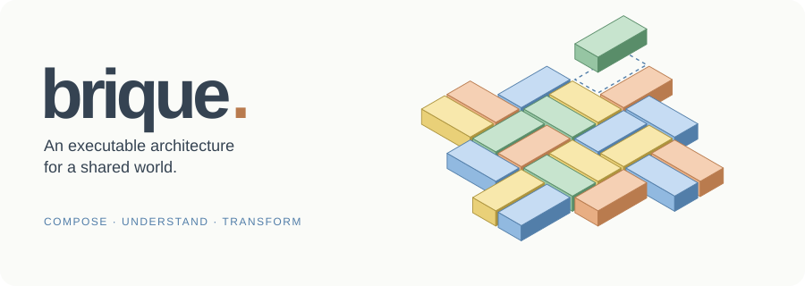

<p align="center">
  <picture>
    <source media="(prefers-color-scheme: dark)" srcset="docs/assets/landing/hero-dark.svg">
    
  </picture>
</p>

# Brique

Brique is an open-source executable architecture framework. It makes responsibilities, transformations, state and intentions explicit in a shared world that humans, software and language models can understand, operate and evolve.

Think of workshops nested within workshops: each has its own responsibility, materials and possible gestures. Together, they make a larger work possible.

> **Status: experimental.** Brique is under active development; its interfaces and formats may still change.

## A world made of composable elements

| Context | Matter | Capacity | Intention |
| :--- | :--- | :--- | :--- |
| Situates a responsibility. | Carries substance and state. | Expresses a possible transformation. | Addresses a Capacity and sets it in motion. |

Contexts nest within one another, and every element carries meaning. A shared semantic vocabulary makes elements discoverable beyond their location.

## An executable world

A Go engine executes this architecture. Capacities are resolved as DSL compositions or through wrappers written in Python, Go or C++, and each execution can be recorded as a Trace. Instances communicate over signed HTTPS, under a security policy administered with Brique Sec.

The bundled agentic environment, itself built with Brique, provides **Pilots** and **Continuities**: language models inhabit this world through situated, persistent cognitive activities. External agents reach it through MCP.

## Discover Brique

[Discover the architecture, the agentic environment, and how to build with Brique →](https://brique-oss.github.io/brique/)

## Quick start

Requires Git, Node.js with npm and Go 1.26; Python 3 for Python-backed Capacities.

```bash
git clone https://github.com/brique-oss/brique.git
cd brique
npm run setup
npm run launcher
```

`npm run setup` builds the engine, the launcher and the VS Code extension (`npm run setup -- --dry-run` lists what it would do). To create an instance and connect a language model, continue with [Bring a world into operation](https://brique-oss.github.io/brique/#bring-a-world-into-operation).

[Engine](engine/README.md) · [Security](engine/SECURITY.md) · [Apache 2.0](LICENSE)
