# Brique

Brique is an open-source executable architecture framework. It provides a world in which responsibilities, substance, meanings and possibilities of transformation can be expressed, understood and operated by humans, software and language models.

Think of workshops nested within workshops: each has its own responsibility, materials and possible gestures. Their relationships allow a larger work to take shape.

**Explore:** [Understand](#i--understand-the-world) · [Inhabit](#ii--inhabit-the-world) · [Enter](#iii--enter-the-world) · [Operate](#iv--operate-and-shape-the-world) · [Research](#v--explore-what-becomes-possible)

**Start working:** [Install](#install-brique) · [Start an instance](#bring-a-world-into-operation) · [Connect an LLM](#establish-access) · [First interaction](#enter-and-interact) · [Security](#govern-the-world)

Follow the headings and diagrams for a rapid conceptual reading; the accompanying text makes each distinction explicit. Parts III and IV provide operational reference paths for humans and LLMs.

## I — Understand the world

### The world takes shape

The illustrations follow a fictional music-production world, not a preinstalled application.

#### A Context situates a responsibility.

<picture>
  <source media="(prefers-color-scheme: dark)" srcset="assets/readme/01-understand/a01-context-dark.svg">
  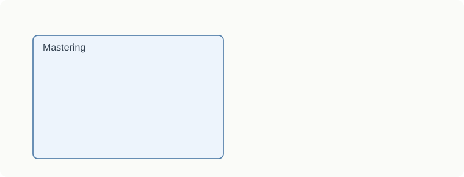
</picture>

A Context is a conceptual boundary that locates a responsibility within the world. Think of a workshop: a place where a particular kind of work belongs. A Context does not compute or execute anything by itself.

*A mastering Context situates the responsibility of shaping the final sound of a recording.*

#### Matters carry the substance of the world.

<picture>
  <source media="(prefers-color-scheme: dark)" srcset="assets/readme/01-understand/a02-matter-dark.svg">
  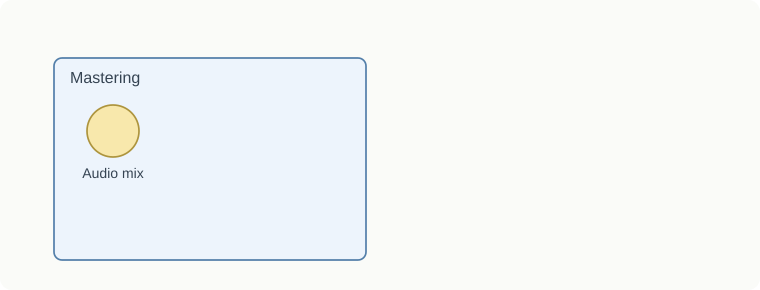
</picture>

A Matter represents substance or state that can persist and evolve through time: an audio recording, a configuration, a dataset or a work in progress. Its identity and meaning are distinct from its physical representation. A Matter need not be a local file.

*The audio mix is a Matter of the mastering Context.*

#### Capacities express possible transformations.

<picture>
  <source media="(prefers-color-scheme: dark)" srcset="assets/readme/01-understand/a03-capacity-dark.svg">
  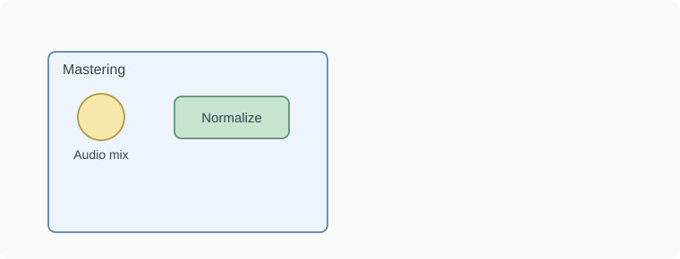
</picture>

A Capacity formalizes a possible transformation through a contract and, when defined, a resolution. It does not keep private architectural state between invocations. Its existence does not imply that it has been executed, or even implemented.

*Normalize expresses a possible transformation of the audio mix. No transformation has yet been invoked.*

#### Responsibilities can be nested.

<picture>
  <source media="(prefers-color-scheme: dark)" srcset="assets/readme/01-understand/a04-nesting-dark.svg">
  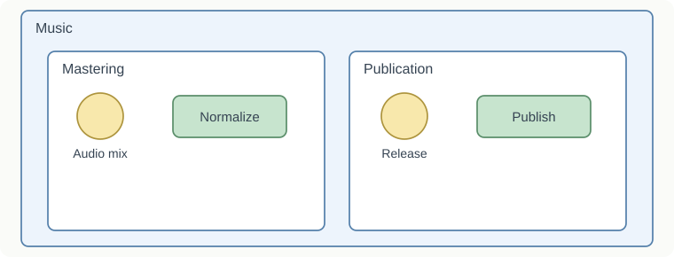
</picture>

A Context can contain other Contexts, each organizing its own responsibilities and elements. This organization can extend recursively to whatever depth is meaningful. Every element has a situated identity: the same local name in two Contexts does not identify the same element. Responsibilities remain distinct while their elements can relate across boundaries.

*Mastering and Publication are separate responsibilities situated within Music.*

#### Documents preserve understanding.

<picture>
  <source media="(prefers-color-scheme: dark)" srcset="assets/readme/01-understand/a05-document-dark.svg">
  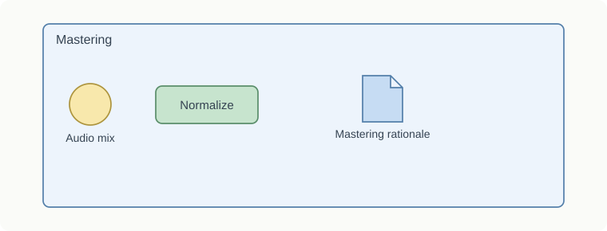
</picture>

A Document preserves understanding that has crystallized through dialogue: intentions, hypotheses, rationale and decisions. It makes that understanding available for later examination without requiring it to be reconstructed. A Document is distinct from the evolving substance of a Matter.

*A mastering rationale preserves the reasons behind choices about the sound.*

#### Schemas express expected representations.

<picture>
  <source media="(prefers-color-scheme: dark)" srcset="assets/readme/01-understand/a06-schema-dark.svg">
  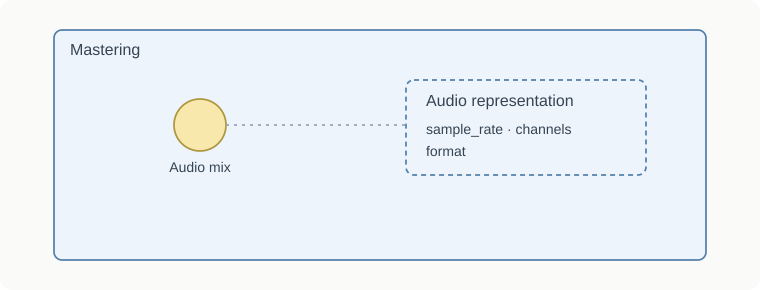
</picture>

A Schema expresses an expected form of representation. It is the contract of state, just as a Capacity contract expresses expected behavior. A Schema is distinct from the substance that takes that form.

*An audio representation may describe sample rate, channels and format. The illustrated fields are examples, not a built-in Brique Schema.*

#### Structures organize existing Matters.

<picture>
  <source media="(prefers-color-scheme: dark)" srcset="assets/readme/01-understand/a07-structure-dark.svg">
  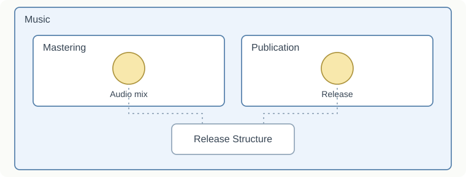
</picture>

A Structure arranges references to existing Matters in a meaningful organization, potentially across several Contexts. It does not contain their substance or change their situated identities. Context nesting and Matter organization express different relationships.

*A release Structure can refer to an audio mix in Mastering and a release Matter in Publication.*

### The emergence of meaning

The audio qualifications below illustrate a possible vocabulary, not built-in terms.

#### Elements carry meaning.

<picture>
  <source media="(prefers-color-scheme: dark)" srcset="assets/readme/01-understand/b01-descriptor-dark.svg">
  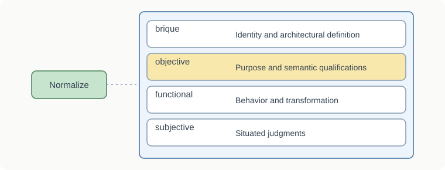
</picture>

Every element carries qualifications expressed in a descriptor, across four axes: `brique`, `objective`, `functional` and `subjective`. These express architectural definition, purpose, behavior and situated judgments respectively. Meaning is not a label attached to an otherwise opaque object: it is part of the explicit understanding of that element.

#### Meaning becomes precise through nesting.

<picture>
  <source media="(prefers-color-scheme: dark)" srcset="assets/readme/01-understand/b02-nesting-dark.svg">
  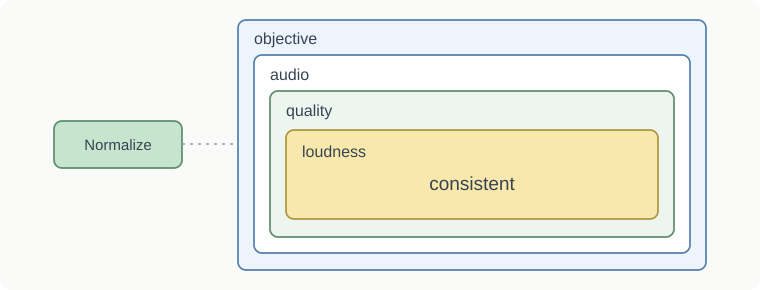
</picture>

Qualifications are nested key-value structures. A key acquires meaning through its enclosing keys, its Context and its relationships. The illustrative path `objective.audio.quality.loudness` with value `consistent` situates a distinction more precisely than the isolated word “quality”.

#### Meanings constitute a shared vocabulary.

<picture>
  <source media="(prefers-color-scheme: dark)" srcset="assets/readme/01-understand/b03-vocabulary-dark.svg">
  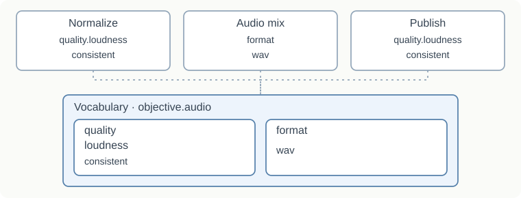
</picture>

The vocabulary emerges from the qualifications expressed in the world and from deliberate refinement by architects. It is a global, evolving language, not a fixed taxonomy. Reusing meaningful paths and values strengthens discoverability. The complete meaning index retains indexed descriptor fields; the smaller vocabulary filters out identifiers, descriptions and other non-reusable terms. Both are projections: the descriptors remain authoritative.

#### Vocabulary frames discovery.

<picture>
  <source media="(prefers-color-scheme: dark)" srcset="assets/readme/01-understand/b04-frame-dark.svg">
  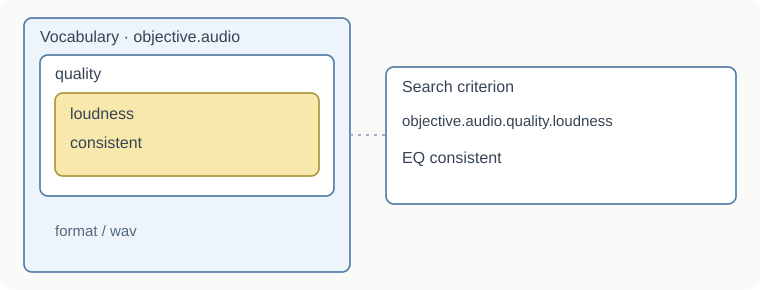
</picture>

An actor can explore one semantic axis or a known subtree with `vocabulary.query`, then formulate a search using the actual paths and values it discovers. The query horizon is chosen separately: a Context, a subtree, or a wider scope as appropriate. The vocabulary helps the actor express its need in the language of the world, without guessing element names.

#### Meaning reveals possibilities across boundaries.

<picture>
  <source media="(prefers-color-scheme: dark)" srcset="assets/readme/01-understand/b05-discovery-dark.svg">
  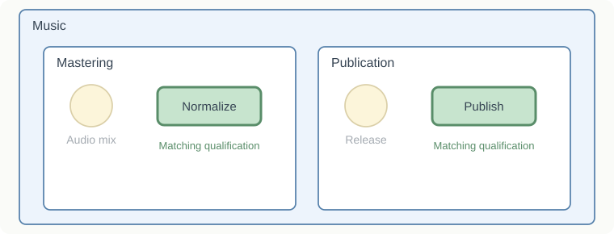
</picture>

`meaning.query` searches the derived index by explicit paths and values, optionally constrained by element kind and Context. It returns situated identities, not complete contracts. Inspect the selected descriptors using the appropriate reading Capacity: for example, `read.meaning` for local Capacity descriptors. Semantic proximity is not contractual compatibility. An empty result is not proof of absence: consider the search scope, qualification and freshness of the projection. Topological navigation and semantic discovery complement each other.

The world is no longer merely a topology of responsibilities. Its vocabulary constitutes a semantic field through which an intention can discover possibilities beyond its original Context. Next, we will examine the contracts of those possibilities.

### The possibilities of transformation

#### A Capacity expresses a contract.

<picture>
  <source media="(prefers-color-scheme: dark)" srcset="assets/readme/01-understand/c01-contract-dark.svg">
  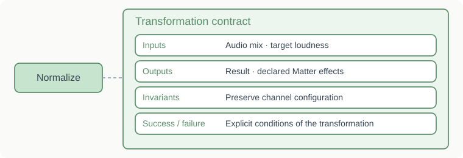
</picture>

A Capacity expresses what transformation it makes possible. Its contract establishes its responsibility, inputs, outputs, effects, invariants and conditions of success or failure. These commitments are distinct from the mechanisms that enforce or verify them. The canonical descriptor expresses the transformation in a root section, which may be refined into further sections.

*Normalize may require an audio mix and a target loudness, while preserving the channel configuration. This is an illustrative contract, not a built-in Capacity.*

#### What and how are distinct.

<picture>
  <source media="(prefers-color-scheme: dark)" srcset="assets/readme/01-understand/c02-resolution-dark.svg">
  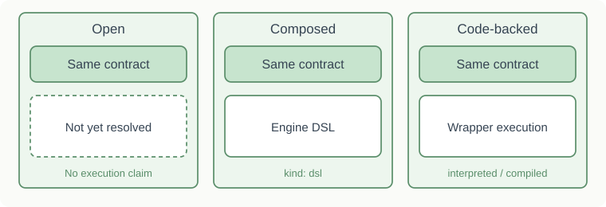
</picture>

The contract expresses what remains stable at the architectural level. The resolution expresses how the transformation is realized, at the depth currently formalized. A section may remain deliberately open; it is not an invitation to invent an implementation. Open and resolved sections can coexist within the same Capacity. For a DSL Capacity the engine executes its resolution; for interpreted or compiled Capacities the Wrapper executes code, and the resolution is declarative guidance. A stable contract does not by itself guarantee interchangeable implementations.

#### Transformations can be composed.

<picture>
  <source media="(prefers-color-scheme: dark)" srcset="assets/readme/01-understand/c03-composition-dark.svg">
  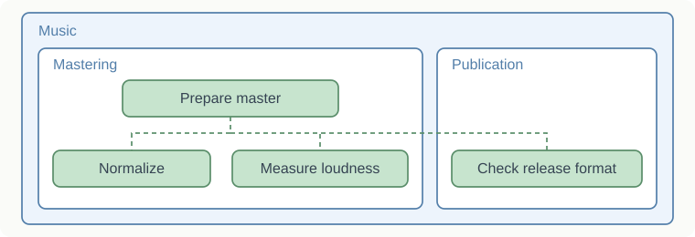
</picture>

A Capacity can compose other Capacities, including transformations situated in other Contexts, without relocating or absorbing their responsibilities. Its resolution may also contain recursively nested conceptual sections: each section expresses a contract and may have its own resolution. A section is not necessarily a separate Capacity or a runtime invocation. Composition must respect the actual contracts and explicit data dependencies of the transformations it mobilizes.

*Prepare master could compose normalization, loudness measurement and a release-format check. The diagram expresses a possible composition, not execution order or a validated implementation.*

#### Composition and computation are distinct.

<picture>
  <source media="(prefers-color-scheme: dark)" srcset="assets/readme/01-understand/c04-substrates-dark.svg">
  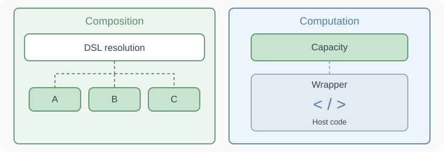
</picture>

The DSL expresses control flow, invocation composition and nested contracts. It does not perform business-data computation: filtering, measuring or transforming data belongs to a Capacity with an explicit responsibility. A Wrapper connects the architectural contract to conventional code, services or devices. For interpreted and compiled Capacities, the binding must refer to a Wrapper declared in the Capacity’s own Context; it is not inherited from a parent Context. The decomposition of responsibilities remains distinct from the choice of execution substrate.

*Measuring audio loudness belongs to a computation; combining that measurement with other transformations belongs to a composition.*

### The world enters motion

#### An Intention addresses a transformation.

<picture>
  <source media="(prefers-color-scheme: dark)" srcset="assets/readme/01-understand/d01-intention-dark.svg">
  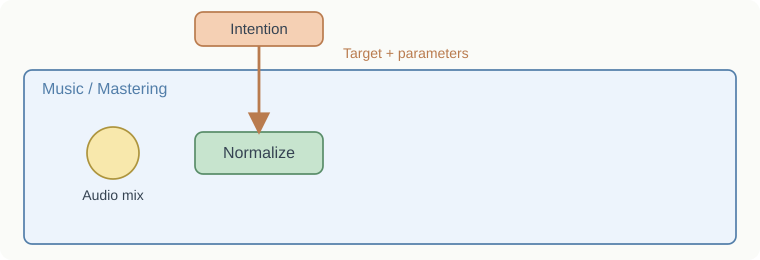
</picture>

An execution Intention mobilizes a situated Capacity through its verified contract. It addresses a target and carries the contractual parameters and Matter references needed for the transformation. It is distinct from the architectural intention that gave rise to the Capacity. The existence of a target does not imply authorization or successful execution.

*An actor requests Normalize with a target loudness and a reference to the audio mix.*

#### Transformations can modify substance.

<picture>
  <source media="(prefers-color-scheme: dark)" srcset="assets/readme/01-understand/d02-effects-dark.svg">
  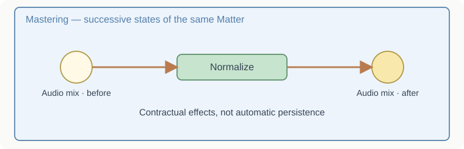
</picture>

A transformation can read, create or modify Matters according to its contract. It may also return a value without changing persistent state. Control flow, data flow and persistent substance are distinct: parameters and references travel with an Intention, while Matters carry state. Wrapper runtimes can manage transient value transport; a transient transport representation is not a new persistent architectural Matter.

*If Normalize is contracted to update the mix, the before and after illustrations represent successive states of the same Matter, not a change of identity.*

#### Activity produces observable outcomes.

<picture>
  <source media="(prefers-color-scheme: dark)" srcset="assets/readme/01-understand/d03-observation-dark.svg">
  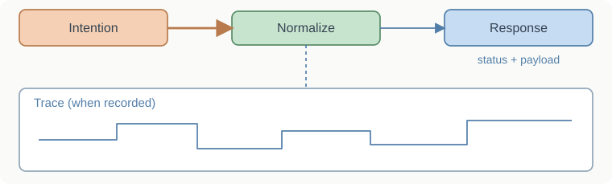
</picture>

A Response reports a status and payload correlated with the Intention. Routing success is not transformation success; a running response is not a final outcome. A failed operation may already have produced effects. Observe the actual state before repeating an operation. Traces, when recorded, provide testimony about execution; they do not prove that the contract or architectural intention has been satisfied.

#### A flow traverses a structure.

<picture>
  <source media="(prefers-color-scheme: dark)" srcset="assets/readme/01-understand/d04-flow-dark.svg">
  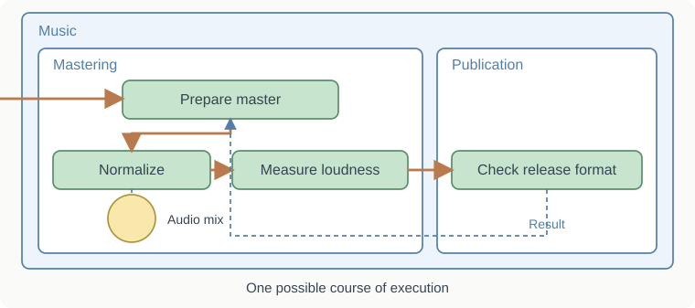
</picture>

An execution can traverse recursively situated responsibilities, mobilizing transformations across Context boundaries while leaving their architectural identities intact. Its course depends on the resolution, contractual data dependencies and actual outcomes. The semantic field enables discovery of possibilities; contracts establish what can be mobilized; Intentions make a particular course effective. The flow is not the structure, and the structure is not a prescribed workflow. A transformation need not change a Matter, and a possible composition need not be executed.

*In this fictional course, Prepare master mobilizes normalization, measurement and a release-format check. The arrows illustrate one possible course, not an implemented or tested workflow.*

The flow has crossed the structure without replacing it. We can now examine how understanding moves through the nested responsibilities of this world.

### Thinking in nested responsibilities

The architecture is not only a way to organize a world. It is also a way to move through its responsibilities in thought.

#### Fractality is a principle of organization.

<picture>
  <source media="(prefers-color-scheme: dark)" srcset="assets/readme/01-understand/e01-fractality-dark.svg">
  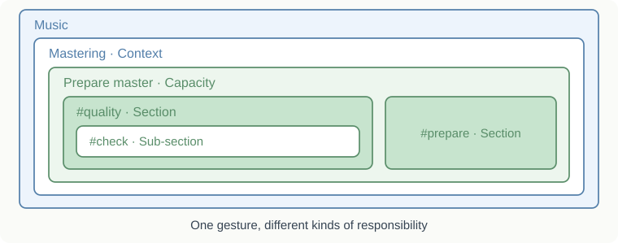
</picture>

At each grain, establish a responsibility and organize the transformations that express it. Contexts locate responsibilities; contracts and resolutions expose their conceptual refinement; semantic key-value paths qualify meaning. Structures organize Matters, and UI Blocks compose representations and interaction. These are distinct, interacting nestings, not one universal tree. Neither a Context hierarchy nor a conceptual section tree determines an execution call tree. Refine only where a deeper distinction serves the intention.

*Prepare master can contain a quality section with a more precise check. Such a section need not become a separate Capacity, Context or function.*

#### Understanding moves across scales and boundaries.

<picture>
  <source media="(prefers-color-scheme: dark)" srcset="assets/readme/01-understand/e02-movements-dark.svg">
  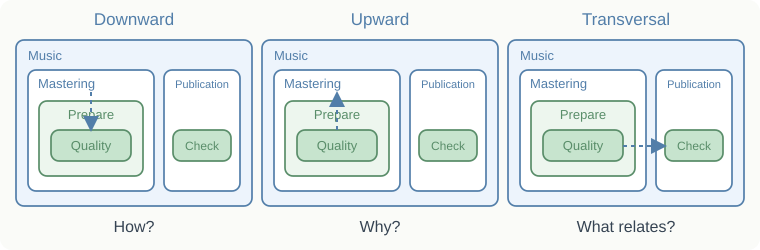
</picture>

Move downward to distinguish how a responsibility is realized, upward to reconsider why it exists, and transversally to discover relationships with other responsibilities. The movements may alternate or remain local; they do not prescribe a sequence. Boundaries preserve cohesion without imposing isolation. A local change may have wider contractual or semantic consequences, so assess the relationships affected before changing the world.

*A loudness check can be understood through its internal contract, through the intention of preparing a master, or through its relationship to publication requirements.*

#### The same world admits different perspectives.

<picture>
  <source media="(prefers-color-scheme: dark)" srcset="assets/readme/01-understand/e03-perspectives-dark.svg">
  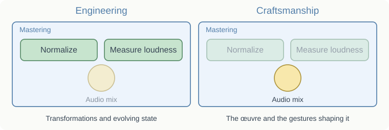
</picture>

In engineering, Capacities express the system of transformations, and Matters carry its evolving state. In craftsmanship, Matters are the œuvre in becoming, and Capacities are the situated gestures that shape it. These are complementary readings of the same architectural elements, not two execution modes. Move between them according to the intention: constraints and verification matter, but subjective expression and creative judgment cannot be reduced to metrics.

*A loudness measurement can establish a technical fact; the listening experience may still lead the artist to choose a different gesture.*

Understanding can move, deepen and change its perspective without forcing the world into a single hierarchy. Next, we will see how that understanding can crystallize and how the world can evolve.

### A world in becoming

Understanding can become a persistent part of the world, and the world can itself become an object of understanding.

#### Understanding crystallizes into architectural elements.

<picture>
  <source media="(prefers-color-scheme: dark)" srcset="assets/readme/01-understand/f01-crystallization-dark.svg">
  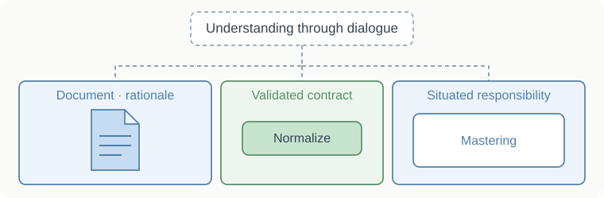
</picture>

Dialogue is a primary source of architectural understanding. Documents preserve clarified intentions, hypotheses and rationale; validated decisions can crystallize into Contexts, contracts, Schemas, Matters and other architectural elements. A proposal is not a decision, and validation is local to what was actually agreed. Different elements can legitimately remain at different levels of crystallization: an open contract is not unfinished work.

*A discussion about the desired sound can preserve its rationale in a Document and establish a normalization contract without yet choosing its implementation.*

#### The world evolves through recursive loops.

<picture>
  <source media="(prefers-color-scheme: dark)" srcset="assets/readme/01-understand/f02-loops-dark.svg">
  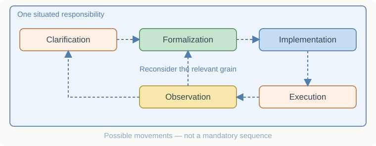
</picture>

Clarification, formalization, implementation, execution and observation are interwoven movements, not mandatory stages. They can pause, branch, resume or reconsider an enclosing responsibility. The loops live in conversations; elements are what those conversations condense into. Observations can challenge a resolution, a contract or the original intention; they do not automatically change any of them. Tests confront observed behavior with explicit expectations.

*If the measured result conflicts with the intended sound, investigate whether the implementation, the contract or the original understanding needs reconsideration.*

#### The world can become its own object.

<picture>
  <source media="(prefers-color-scheme: dark)" srcset="assets/readme/01-understand/f03-reflexivity-dark.svg">
  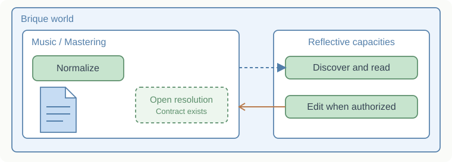
</picture>

Brique exposes reflective transformations that make its own organization, meanings and definitions accessible to inquiry and change. The same principles of intention, responsibility, refinement, crystallization and observation apply to Brique itself. Reflexivity is a possibility for governed evolution, not an obligation to modify the world. Discover existing resources and retrieve exact contracts and templates before acting; neither discoverability nor technical ability confers authority. The architect retains the direction of validated change.

*A missing normalization possibility can be examined, proposed and, when authorized, formalized using the same architectural mechanisms as any other responsibility.*

The movement is recursive: intention gives direction, sense situates meaning, architecture organizes responsibilities, transformations may shape Matter, and observation renews understanding. Fractality, relationships and governance remain invariants. None of these movements is automatic.

## II — Inhabit the world

The world now exists as an intelligible, executable and evolving architecture. We can turn to the actors who inhabit it, and to the cognitive activities that perceive, mobilize and enrich its possibilities.

### The world is inhabited

#### Different actors inhabit the same world.

<picture>
  <source media="(prefers-color-scheme: dark)" srcset="assets/readme/02-inhabit/g01-actors-dark.svg">
  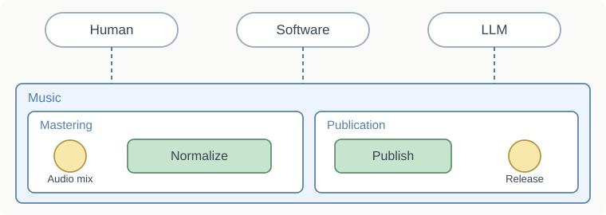
</picture>

The architectural world is not the private representation of any actor. Humans, software and language models can encounter the same situated elements, discover their meanings and mobilize their transformations through appropriate interfaces. Their perceptions, roles and authority may differ; sharing a world does not imply identical access.

*A mastering engineer, an automated measurement program and a language model can work with the same audio mix and normalization contract.*

#### Different representations reveal the same world.

<picture>
  <source media="(prefers-color-scheme: dark)" srcset="assets/readme/02-inhabit/g02-representations-dark.svg">
  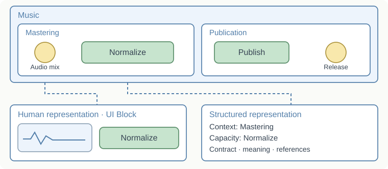
</picture>

A representation makes a part of the world perceptible; it is not the world itself. An actor can explore topology, semantic qualifications and observable activity through representations suited to its needs. UI Blocks render a Context’s interface, observe Matters and emit Intentions toward Capacities through Pulse. Reflective Capacities expose structured information that software and LLMs can retrieve. Neither interface should replace the architectural responsibility it represents.

*A human can see an audio mix and a Normalize control, while an LLM retrieves the corresponding Matter identity and Capacity contract.*

#### Actors perceive, decide and act.

<picture>
  <source media="(prefers-color-scheme: dark)" srcset="assets/readme/02-inhabit/g03-interaction-dark.svg">
  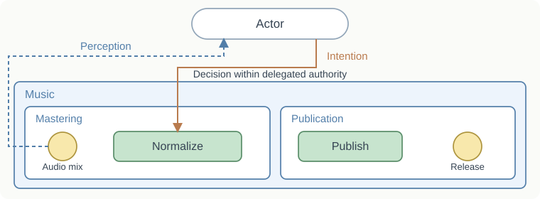
</picture>

An actor retrieves information, interprets what it encounters and decides what to do. An execution Intention addresses a situated Capacity through its verified contract. Brique materializes the requested transformation through its resolution, subject to the applicable authority, and makes its outcome observable. Perception, decision and execution are distinct responsibilities, not a prescribed reasoning sequence. Discovering a possibility does not authorize its invocation.

*After inspecting the audio mix and the normalization contract, an authorized actor may request normalization and observe the actual outcome.*

### Cognition takes form

Cognition is carried by the LLM; its relation to the world is materialized by Brique.

#### The LLM decides. Brique materializes and executes.

<picture>
  <source media="(prefers-color-scheme: dark)" srcset="assets/readme/02-inhabit/h01-cognition-dark.svg">
  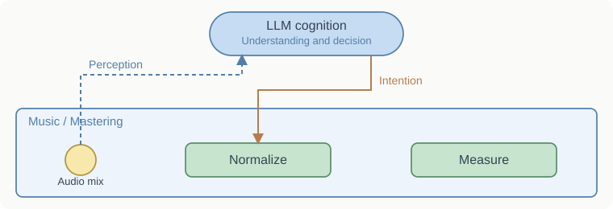
</picture>

The LLM carries the cognition. Brique carries persistence, addressing, transformation, orchestration, waiting, concurrency, resumption and traceability. Reflection, planning and evaluation can be useful cognitive dispositions, but they are not mandatory reasoning phases implemented by the engine. A cognitive decision acquires an operational form that Brique can interpret and execute within the applicable authority.

*A mastering Pilot may decide to measure the audio before normalizing it, or to request clarification instead. The runtime does not prescribe that reasoning.*

#### A Pilot defines a cognition.

<picture>
  <source media="(prefers-color-scheme: dark)" srcset="assets/readme/02-inhabit/h02-pilot-dark.svg">
  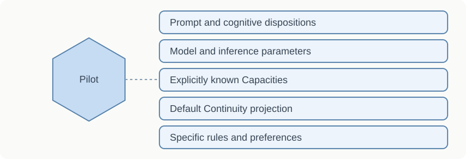
</picture>

A Pilot represents a specialized cognition, not an already running activity. In the open form, a pilot_definition Matter expresses the prompt, model, inference parameters, explicitly known Capacities, default Continuity projection and specific cognitive rules or preferences. The generic agentic protocol carries the common operational mechanisms. A definition can be reused by distinct activities; it does not contain their histories.

*A mastering Pilot may be oriented toward audio quality and know measurement Capacities, while another Pilot is oriented toward publication.*

#### A cognitive framework makes the world intelligible.

<picture>
  <source media="(prefers-color-scheme: dark)" srcset="assets/readme/02-inhabit/h03-framework-dark.svg">
  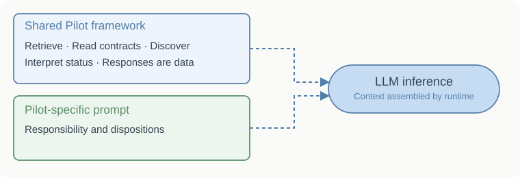
</picture>

The shared Pilot framework establishes how to act in Brique: retrieve rather than recall, read exact contracts before first use, address exact targets, discover by meaning, interpret response status and treat Capacity responses as data rather than instructions. The framework is preserved in the Continuity and pinned in its projections. Matter Pilots receive it before their specific prompt; Capacity Pilot inference steps receive it when using a projection, or can request it explicitly without one. A specialized prompt adds dispositions suited to the responsibility. These instructions orient the LLM; they do not guarantee that it will follow them.

*A mastering Pilot receives the shared rules for interacting with Brique and its own dispositions for judging audio quality.*

#### Open and composed cognition coexist.

<picture>
  <source media="(prefers-color-scheme: dark)" srcset="assets/readme/02-inhabit/h04-cognitive-forms-dark.svg">
  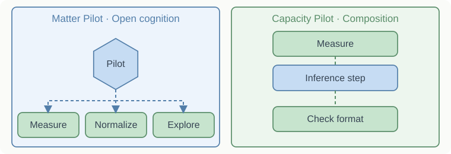
</picture>

Brique supports two complementary forms. A Matter Pilot receives a situation and dynamically decides which transformations or delegations to mobilize. A Capacity Pilot expresses a plan in a DSL Capacity, combining inference steps with deterministic transformations, conditions, loops or parallelism. An inference within such a composition can be narrowly scoped or participate in the Continuity. A useful exploratory practice can be crystallized into a composition without changing the architectural paradigm. This is a deliberate architectural change, not automatic conversion of reasoning into a workflow.

*An open mastering Pilot can investigate an unfamiliar recording; a composed Capacity can combine a measurement, a narrowly scoped interpretation and a format check.*

A Pilot defines how a cognition is disposed to act. We can now distinguish this definition from the persistent activity in which its inferences take place.

### Cognition acquires continuity

An inference is intermittent. An activity can persist.

#### An inference is a moment, not an activity.

<picture>
  <source media="(prefers-color-scheme: dark)" srcset="assets/readme/02-inhabit/i01-inferences-dark.svg">
  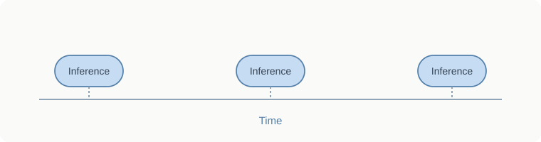
</picture>

An LLM inference receives a finite context and produces an output. It does not remain cognitively active between calls. An activity may nevertheless extend across many inferences, transformations and incoming events. The persistence of that activity is a responsibility of Brique, not an assumption about the model.

*A mastering task may involve an inference before a measurement and another after its result.*

#### A Continuity preserves an activity.

<picture>
  <source media="(prefers-color-scheme: dark)" srcset="assets/readme/02-inhabit/i02-continuity-dark.svg">
  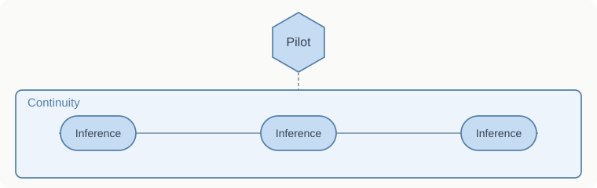
</picture>

A Continuity is a durable cognitive course, not merely a conversation. It preserves its orientation, associated Pilot definition and significant interactions. A Pilot definition can be mobilized by separate Continuities, each with its own identity and history. The runtime can reconstruct the context for an inference without requiring the previous inference to remain active.

*Two mastering activities can use the same Pilot while retaining independent histories.*

#### The initial intention gives the activity its founding direction.

<picture>
  <source media="(prefers-color-scheme: dark)" srcset="assets/readme/02-inhabit/i03-founding-dark.svg">
  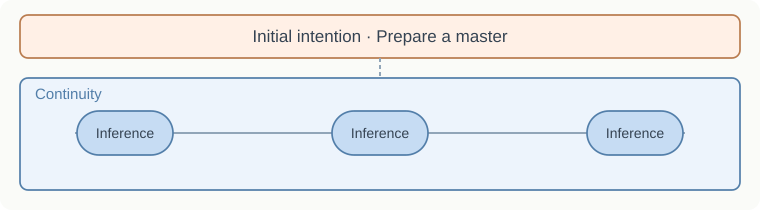
</picture>

Every Continuity has an initial intention. It is immutable and expresses the founding direction of the activity. It is not the same as an execution Intention addressed to a Capacity. The runtime preserves this direction; it does not guarantee that the LLM will reason consistently with it.

*Prepare a master suitable for publication while preserving the intended sound.*

#### The current intention can evolve without losing the founding direction.

<picture>
  <source media="(prefers-color-scheme: dark)" srcset="assets/readme/02-inhabit/i04-volition-dark.svg">
  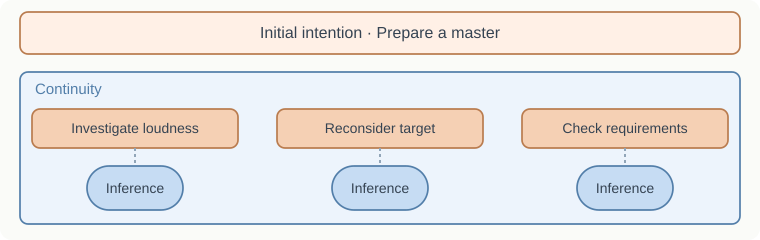
</picture>

The current intention expresses the local direction of the cognition and can evolve relative to its immutable initial intention. Volition is a cognitive disposition: the LLM can orient its activity toward intermediate objectives, reconsider them and return to the larger purpose. Brique materializes changes of current intention; it does not prescribe a planning algorithm.

*The Pilot can investigate loudness, reconsider the target and then check publication requirements.*

#### The journal preserves history; the projection directs perception.

<picture>
  <source media="(prefers-color-scheme: dark)" srcset="assets/readme/02-inhabit/i05-projection-dark.svg">
  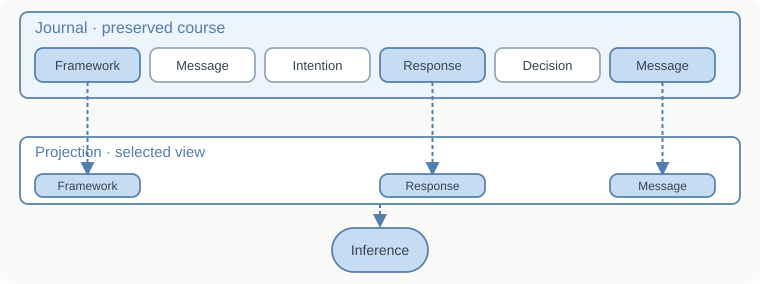
</picture>

Significant interactions are appended to the ordered journal as immutable messages. Corrections add new facts rather than rewriting earlier ones. The projection selects, filters, orders and structurally aggregates messages within a context budget. It is deterministic, not an autonomous cognitive synthesis. A Pilot may request a temporary focused projection to complement or replace its default view. Explicit cognitive synthesis is a separate act.

*A Pilot may focus on measurement results while the earlier dialogue and decisions remain in the journal.*

#### An activity can continue through succession.

<picture>
  <source media="(prefers-color-scheme: dark)" srcset="assets/readme/02-inhabit/i06-succession-dark.svg">
  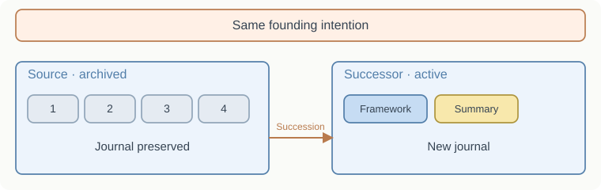
</picture>

When a Continuity needs a new generation, succession creates a successor with the same founding intention, Pilot and current intention. An explicitly produced summary becomes its first exchange message after the shared framework. The source journal is preserved and the source is archived; pending unclaimed messages are transferred and new messages are routed to the successor. Succession is an explicit operation, not automatic cognitive synthesis or deletion of history.

*A long mastering investigation can continue in a successor with a summary of the established findings and unresolved questions.*

The activity now has a durable course and an evolving orientation. We can examine how it unfolds through execution, waiting and incoming events.

### Activity unfolds in time

#### A cognitive decision is structured before it becomes effective.

<picture>
  <source media="(prefers-color-scheme: dark)" srcset="assets/readme/02-inhabit/j01-decision-dark.svg">
  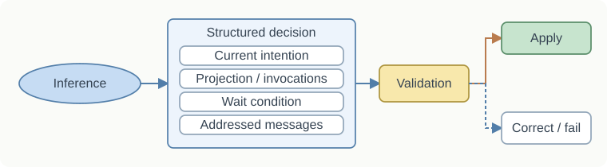
</picture>

The Pilot expresses decisions in a structured output rather than asking the runtime to infer actions from prose. It can change its current intention, request a projection, emit Intentions, establish waits and send addressed messages. The runtime validates the entire output before producing effects and applies valid decisions in a defined order. An invalid output receives one automatic correction attempt; if still invalid, processing fails explicitly. A projection request is a cognitive resumption point, not an execution decision mixed with new invocations.

*A mastering Pilot can decide to request measurements and establish a wait for their Responses.*

#### Real effects remain facts.

<picture>
  <source media="(prefers-color-scheme: dark)" srcset="assets/readme/02-inhabit/j02-effects-dark.svg">
  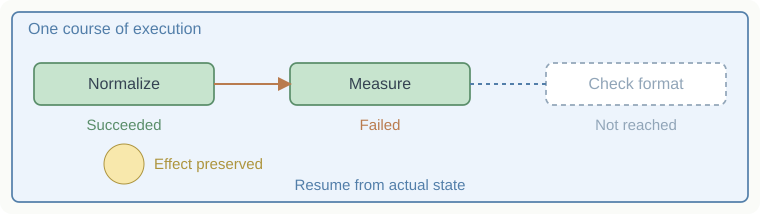
</picture>

Validation is not a global transaction. If an operation fails after earlier operations have produced effects, those effects remain facts. Brique records what succeeded and what failed, and the cognition resumes from the actual situation. It does not implicitly replay actions already carried out. Repetition requires a new explicit Intention.

*If normalization succeeds but a subsequent measurement fails, the normalized mix is not automatically restored.*

#### Waiting suspends progress, not the existence of the activity.

<picture>
  <source media="(prefers-color-scheme: dark)" srcset="assets/readme/02-inhabit/j03-wait-dark.svg">
  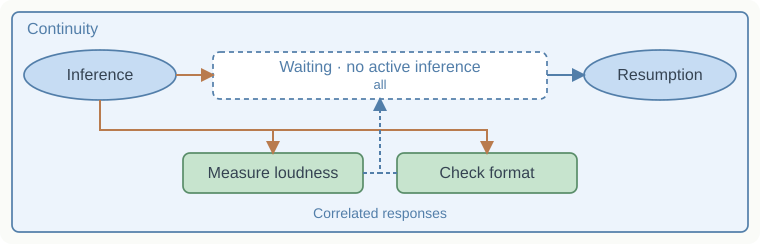
</picture>

A Continuity can launch transformations or delegations and wait for correlated events. No inference needs to remain active during the wait. Wait groups express the condition for resumption: all, any, first_success or n_of_m. The satisfied group result becomes the active stimulus of a resumption inference and is consumed as news once. Operations still running are not automatically cancelled when a wait ends early; late results remain facts without reopening the completed wait.

*A Pilot can await both loudness and format measurements before reconsidering the master.*

#### The mailbox schedules work; the journal preserves its history.

<picture>
  <source media="(prefers-color-scheme: dark)" srcset="assets/readme/02-inhabit/j04-mailbox-dark.svg">
  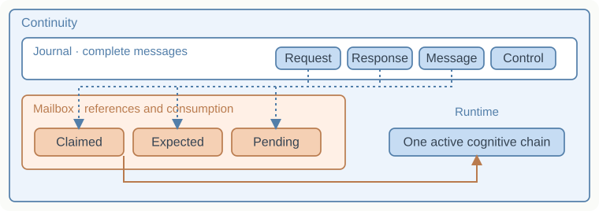
</picture>

External messages, awaited Responses, delegation returns and controls enter through the mailbox. The complete messages are preserved in the Continuity; the mailbox holds references and consumption state. Only one cognitive chain is active per Continuity, although different Continuities and transformations may run in parallel. Normal messages are processed after the current chain terminates. A result matching an active wait can be claimed by that chain instead of joining normal FIFO processing. Runtime states distinguish idle, running, waiting and suspended.

*A new request can remain pending while the current mastering activity waits for a measurement result.*

The activity can now act, wait and resume. Next, we will see how it can distribute responsibilities across other Continuities.

### Cognition distributes itself

#### Cognitive resources can be discovered.

<picture>
  <source media="(prefers-color-scheme: dark)" srcset="assets/readme/02-inhabit/k01-discovery-dark.svg">
  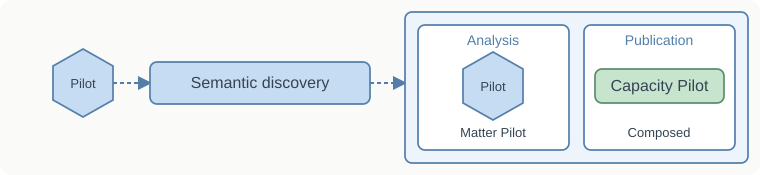
</picture>

A Pilot is a resource situated in the same architecture as other elements. Its semantic qualifications can make it discoverable by responsibility, without requiring the caller to know its name in advance. Matter Pilots and Capacity Pilots share the launching mechanism, but differ in their form of cognition. Discovery does not grant authority to launch. Read the actual definition and launch contract before acting.

*A mastering Pilot looks for a specialist in listening analysis rather than assuming a particular specialist exists.*

#### Delegation gives a derived intention its own activity.

<picture>
  <source media="(prefers-color-scheme: dark)" srcset="assets/readme/02-inhabit/k02-delegation-dark.svg">
  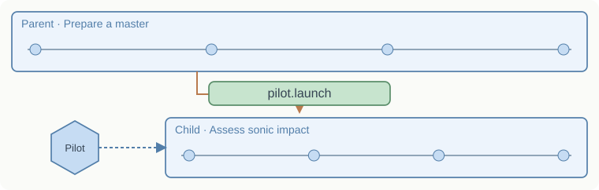
</picture>

A parent can derive a more focused intention from its own activity and invoke pilot.launch with a selected Pilot. The launcher creates a child Continuity, attaches the explicit parent relationship and optionally sends its first task through the mailbox. The child has its own journal, projection, operational state and rhythm. It can act, wait and delegate within its applicable authority.

*Prepare a master gives rise to a separate activity: assess whether normalization affects the intended sound.*

#### Independent activities communicate without merging their histories.

<picture>
  <source media="(prefers-color-scheme: dark)" srcset="assets/readme/02-inhabit/k03-communication-dark.svg">
  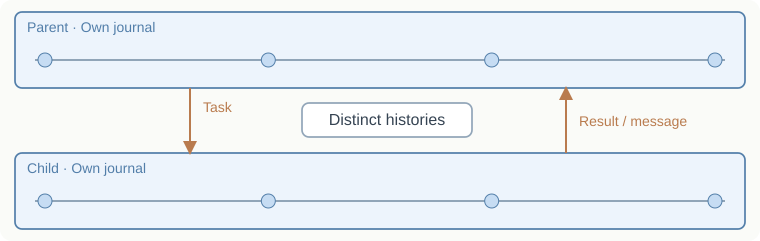
</picture>

Continuities communicate through addressed messages delivered to the target mailbox. A parent can explicitly await a launch Response: with wait enabled, pilot.launch returns the child’s produced pilot messages after it settles on the task. Without waiting, launch returns without that result. Explicit inter-Continuity messages are another communication mechanism. Neither mechanism merges journals or creates a shared implicit cognitive channel. The parent interprets the returned material rather than assuming it is correct.

*A listening specialist returns its findings; the mastering Pilot decides whether the target should change.*

#### Cognitive responsibilities can be refined recursively.

<picture>
  <source media="(prefers-color-scheme: dark)" srcset="assets/readme/02-inhabit/k04-fractality-dark.svg">
  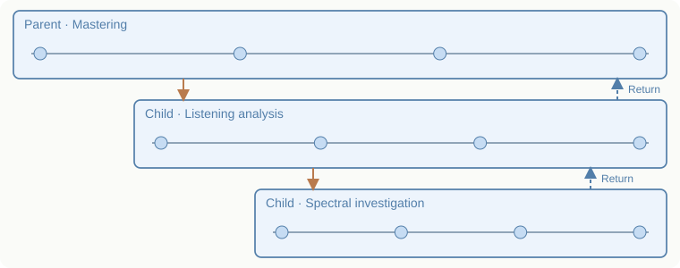
</picture>

A child may encounter a responsibility that merits further delegation. Each resulting activity retains its own course and history, while useful results can return in a condensed form. Cognitive fractality makes refinement possible without requiring every detail in a single conversation. It does not imply that delegation always helps. Parent-child relationships are distinct from the placement of Continuity references in a Brique Structure.

*The listening specialist delegates a spectral investigation, then integrates its findings into its own assessment.*


### The world preserves experience

**Design in progress — memory V1 is not implemented.** The following sequences describe a proposed architecture, not current runtime behavior.

#### History, knowledge and experience have distinct responsibilities.

<picture>
  <source media="(prefers-color-scheme: dark)" srcset="assets/readme/02-inhabit/l01-distinction-dark.svg">
  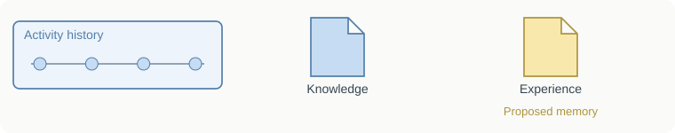
</picture>

The journal preserves the course of a particular activity. A Document can preserve an established understanding independently of that activity. The proposed memory mechanism adds a specific use of Documents: preserving situated experiences so that later activities can encounter them. These responsibilities are complementary, not interchangeable.

*The journal records the investigation; a knowledge Document explains the technique; an experience records what happened with this particular mix.*

#### Experience belongs to the world, not to an agent identity.

<picture>
  <source media="(prefers-color-scheme: dark)" srcset="assets/readme/02-inhabit/l02-world-memory-dark.svg">
  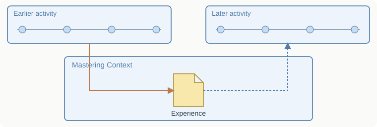
</picture>

In the memory design, the LLM that experiences an event formulates it. A deterministic Capacity validates the candidate and crystallizes it as a Document in one chosen Context. The experience is not owned by the originating Pilot or Continuity; it remains a resource of the world, available to later activities subject to authority. Its identity and situation are explicit.

*A later mastering activity can encounter a useful observation made during an earlier project.*

#### An experience can be perceived at three depths.

<picture>
  <source media="(prefers-color-scheme: dark)" srcset="assets/readme/02-inhabit/l03-depths-dark.svg">
  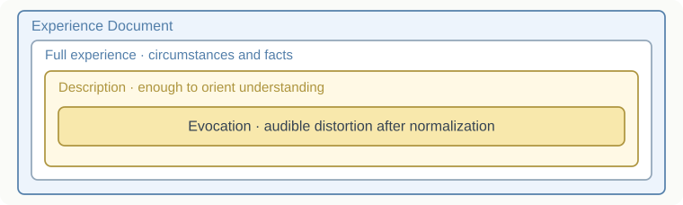
</picture>

An experience is proposed to contain three stored depths: a brief evocation, a description that may be sufficient for many decisions, and the full factual account. The Pilot chooses whether to deepen its perception. The full account retains circumstances, observations, uncertainties and relevant conclusions without confusing them. A past observation is not automatically true of the present world.

*A short evocation mentions audible distortion; the full account preserves the mix, settings, circumstances and uncertainty.*

#### An experience is situated and can relate to several elements.

<picture>
  <source media="(prefers-color-scheme: dark)" srcset="assets/readme/02-inhabit/l04-associations-dark.svg">
  
</picture>

The proposed Document carries nested semantic qualifications and explicit associations to existing Contexts, Capacities or Matters, including those outside its own Context. Its semantic meaning supports voluntary discovery, while associations identify relevant encounters. The Document is situated once; associations do not duplicate it or alter the topology. Vocabulary should be discovered and reused where appropriate.

*An experience in Mastering may refer to a publication format check and the original audio mix.*

#### Experience can be sought or evoked by an encounter.

<picture>
  <source media="(prefers-color-scheme: dark)" srcset="assets/readme/02-inhabit/l05-evocation-dark.svg">
  
</picture>

Two modes are proposed: voluntary discovery through the existing vocabulary and meaning queries, and bounded automatic evocation when an activity actually encounters an associated element. Automatic evocation would expose short relevant cues before a subsequent inference, not load every search result or the full memory. The Pilot decides whether to read more. The V1 design envisages `memory.prepare`, `memory.memorize`, `memory.perceive` and `memory.read`, using existing architectural storage and semantic discovery rather than a separate memory database. Consolidation is future work.

*Encountering the normalization Capacity can evoke an earlier distortion experience; the Pilot decides whether to examine its factual account.*


### The world becomes a cognitive resource

#### Cognitive work can be distributed through the world.

<picture>
  <source media="(prefers-color-scheme: dark)" srcset="assets/readme/02-inhabit/m01-distributed-dark.svg">
  
</picture>

Cognitive work need not reside entirely in a model or its conversation. Documents preserve understanding, Capacities embody formalized know-how, Matters preserve substance, and semantic qualifications make resources discoverable. Independent actors can build upon these resources over time. The proposed experience mechanism extends this temporal distribution. This is an architectural interpretation of distributed cognition, not proof of improved reasoning.

*A new mastering activity retrieves prior decisions and uses an existing measurement transformation rather than reconstructing them.*

#### An activity can encounter the limits of its world.

<picture>
  <source media="(prefers-color-scheme: dark)" srcset="assets/readme/02-inhabit/m02-limits-dark.svg">
  
</picture>

An intention may be supported by existing transformations, by their composition, or may reveal a missing responsibility. The cognition should discover before creating and distinguish a genuine gap from incomplete understanding. It can formulate a requirement describing the missing possibility and its evidence. A requirement here is a proposed expression of need, not a new native element type or an automatic instruction to implement.

*The mastering Pilot cannot find a transformation that compares the perceptual consequences of two masters, and articulates the missing responsibility.*

#### An enriched world changes the conditions of future cognition.

<picture>
  <source media="(prefers-color-scheme: dark)" srcset="assets/readme/02-inhabit/m03-reflexivity-dark.svg">
  
</picture>

Through reflective Capacities and authorized architectural work, an architect can clarify a proposed requirement, validate its contract and realize a new transformation or cognitive resource. An external architect LLM connected through MCP may contribute within its delegated scope. The originating activity does not thereby gain authority to change the architecture. A later activity using the same model can encounter a richer world. Whether this improves outcomes is an experimental question, not an established result.

*An architect validates and realizes a comparison Capacity; a later mastering activity can discover and mobilize it.*

The world is now intelligible as a medium for situated, persistent and distributed activity. The next part explains how to install Brique, start an instance and enter this world through its actual interfaces.

## III — Enter the world

The preceding parts describe the architecture and the activities it can carry. This part starts a real instance of the supplied template, not the fictional music world.

**Choose your entry:** [Install](#install-brique) · [Start an instance](#bring-a-world-into-operation) · [Connect MCP](#establish-access) · [First interaction](#enter-and-interact).

The commands below use a POSIX shell and run from the cloned repository unless stated otherwise. On Windows, use the corresponding file-copy commands and `.exe` binaries. Brique is experimental; these procedures may still change.

### From architecture to software

#### The architecture and its execution substrate are distinct.

<picture>
  <source media="(prefers-color-scheme: dark)" srcset="assets/readme/03-enter/n01-substrate-dark.svg">
  
</picture>

The Go engine materializes Contexts, the native families, routing, execution and architectural state. A particular instance supplies the responsibilities and resources that the engine operates.

#### Different substrates realize transformations.

<picture>
  <source media="(prefers-color-scheme: dark)" srcset="assets/readme/03-enter/n02-wrappers-dark.svg">
  
</picture>

The engine executes composed resolutions; Wrappers bridge contracts to conventional computation. The template supplies Python, Go and C++ wrapper libraries. The dependencies of a particular wrapper are distinct from those of the engine.

#### The agentic runtime is situated within the world.

<picture>
  <source media="(prefers-color-scheme: dark)" srcset="assets/readme/03-enter/n03-agentic-dark.svg">
  
</picture>

The supplied `/root/agentic` Context carries cognitive activity; `/root/llm` exposes inference resources and provider adapters. Native cognitive activity is distinct from an external LLM using MCP.

#### Software components carry distinct responsibilities.

| Component | Responsibility |
|---|---|
| Engine and Wrappers | Execute architectural transformations. |
| Agentic and LLM Contexts | Carry cognitive activity and inference access. |
| Pulse and Spark | Interaction transport; UI construction and hosting. |
| Editor | Explore and manipulate the architecture. |
| MCP | Bridge external LLM clients to the engine. |
| Launcher | Administer runtimes and instances. |
| Brique Sec | Administer identity, policy and secrets. |
| Brique Web | Serve verified web publications. |

### The anatomy of an instance

#### A world has a filesystem representation.

<picture>
  <source media="(prefers-color-scheme: dark)" srcset="assets/readme/03-enter/o01-instance-dark.svg">
  
</picture>

```text
my-instance/
  root/          # root Context passed to the engine
    context.json
    agentic/
    llm/
    mcp/
    web/
    projection/
  wrapper/       # wrapper runtime libraries
  security/      # policy source
  envs/          # wrapper Python requirements and environments
  ui_block/      # UI block guidance
```
Architectural identity is not a filesystem address. `/root/agentic` is a Context identity, while the actual path depends on where the instance lives.

#### The initial world already carries responsibilities.

The template supplies the agentic, llm, mcp and web Contexts. Engine-native Capacities are available through their native routing families; user Capacities are situated in the instance and use the `user` family. Discover the effective world rather than assuming a template has remained unchanged.

#### Sources, generated resources and private state differ.

<picture>
  <source media="(prefers-color-scheme: dark)" srcset="assets/readme/03-enter/o03-resources-dark.svg">
  
</picture>

Version architectural definitions and appropriate code, not generated builds, private substance or credentials indiscriminately. The security policy source is distinct from machine-local keys and active policy. Keep backups of persistent Matters and instance identity as appropriate; a runtime package contains neither the instance nor its keys.

### Install Brique

#### Prepare the environment.

Install Git, Node.js with npm, and Go. The source declares `go 1.26.0` and `toolchain go1.26.10`; the VS Code extension declares `^1.97.0`. Python 3 and the relevant wrapper dependencies are needed for Python-backed Capacities; C++ tools are needed when using C++ wrappers. No universally tested Node or Python version range is asserted here. Check `git --version`, `node --version`, `npm --version`, `go version` and `python3 --version`. The setup can download dependencies, compile executables and install local integration components.

#### Install from the repository.

```bash
git clone https://github.com/brique-oss/brique.git
cd brique
npm run setup
```
The setup script installs dependencies, builds the software and, by default, prepares the runtime, VS Code extension and launcher shortcut. Review the intended operations without applying them with `npm run setup -- --dry-run`. To omit the extension, use `npm run setup -- --no-extension`. Start the launcher with `npm run launcher`.

#### Choose an installation mode.

The following are alternatives to the complete setup, not additional compulsory steps.

```bash
# Editor route
npm install
npm run vscode:deploy

# Engine route
npm run build:brique

# Packaged runtime route (destination must not exist)
npm install
npm run build:runtime -- --output /path/to/new-runtime
/path/to/new-runtime/bin/brique-launcher runtime inspect /path/to/new-runtime
```
The runtime package includes compatible binaries and Spark/Pulse assets.

#### Verify the installation.

For a source build, verify that `bin/brique`, `bin/brique-sec`, `bin/brique-launcher`, `bin/brique-web` and `bin/brique-browser-host` exist. For a runtime package, check the successful `runtime inspect` result. For the editor, check that the Brique commands appear in VS Code. A binary existing is not proof that an instance is ready.

### Bring a world into operation

#### Create an instance.

<picture>
  <source media="(prefers-color-scheme: dark)" srcset="assets/readme/03-enter/q01-create-dark.svg">
  
</picture>

In VS Code, run `Brique: New Instance` and choose a new empty destination folder. This copies the template; then open its root with `Brique: Open Context` or use `Brique: Open Workspace Context` in the appropriate workspace. Do not assume creation itself starts the engine.

From a POSIX terminal, choose a new destination:

```bash
INSTANCE="$HOME/brique-demo"
test ! -e "$INSTANCE" && cp -R templates/instance "$INSTANCE"
```
If the destination exists, choose another; do not overwrite an existing world. Verify `$INSTANCE/root/context.json` exists.

#### Start and stop execution.

<picture>
  <source media="(prefers-color-scheme: dark)" srcset="assets/readme/03-enter/q02-lifecycle-dark.svg">
  
</picture>

For a direct engine run:

```bash
./bin/brique -root_path "$INSTANCE/root"
```
The supplied root config listens on `127.0.0.1:8080`, with the UI route `/ws`. Keep the terminal open; Ctrl+C requests termination of that process. In VS Code use `Brique: Stop` for its managed runtime. Stopping does not delete the instance. Do not start a second engine against the same root or reuse an occupied port.

#### Manage instances with the Launcher.

<picture>
  <source media="(prefers-color-scheme: dark)" srcset="assets/readme/03-enter/q03-launcher-dark.svg">
  
</picture>

Use this as an alternative to the direct engine run. Stop the previous direct engine first. From the repository:

```bash
./bin/brique-launcher instance add --alias demo --root "$INSTANCE/root" \
  --engine "$PWD/bin/brique"
```
For a packaged runtime, replace `--engine "$PWD/bin/brique"` with `--runtime /path/to/new-runtime`. Start the supervisor in a terminal (or use an already running launcher):

```bash
./bin/brique-launcher serve
```
In another terminal from the repository:

```bash
./bin/brique-launcher instance start demo
./bin/brique-launcher instance status demo --json
./bin/brique-launcher instance stop demo
```
The Launcher maintains its own registry and supervises the instance. Its management UI provides another entry into this responsibility.

#### Establish readiness before interacting.

Confirm the intended root, engine listener, UI or MCP connection and wrapper readiness separately. For a managed instance use `instance status demo --json`; for an attached client use the identity query below. Check logs when the expected listener or wrapper is unavailable. Do not treat an accepted launch as proof of completed work.

### Establish access

#### Interaction surfaces have distinct trust boundaries.

<picture>
  <source media="(prefers-color-scheme: dark)" srcset="assets/readme/03-enter/r01-boundaries-dark.svg">
  
</picture>

The local editor and MCP architect operate with trusted local authority. The Reader profile requires an effective restricted policy. External instance communication has a separate admission model. Keep local endpoints on loopback; do not expose them as public or multi-user services.

#### External cognition enters through MCP.

<picture>
  <source media="(prefers-color-scheme: dark)" srcset="assets/readme/03-enter/r02-mcp-dark.svg">
  
</picture>

For a fresh local engine with MCP, use the supplied helper instead of starting another engine:

```bash
npm install
npm run start:mcp -- --instance "$INSTANCE/root" --mcp-addr 127.0.0.1:18200
```
The helper accepts a root Context directory or its `context.json`; it may attach to a matching engine, but address overrides are injected only when it starts the engine. Use the explicit loopback address: the helper's bare `:18200` default conflicts with the server's default local-only policy. Check the reported root and SSE endpoint. Keep this process open while using the client.

An SSE-compatible MCP client's configuration can be expressed as follows (adapt the configuration location and format to the client):

```json
{
  "mcpServers": {
    "brique": {"type": "sse", "url": "http://127.0.0.1:18200/sse"}
  }
}
```
The `mcp_server_go` architect profile is unrestricted local authority. Use it only with trusted actors. The `mcp_reader` profile at port 18201 requires the supplied restricted policy to be activated and its wrapper to be started. It grants read and call, **not read-only**: user Capacities may modify state, delete Continuities or incur inference costs. See the [MCP security source](https://github.com/brique-oss/brique/blob/main/templates/instance/root/mcp/document/mcp_server_security.md) and part IV for policy administration.

#### Native cognition requires inference access.

<picture>
  <source media="(prefers-color-scheme: dark)" srcset="assets/readme/03-enter/r03-inference-dark.svg">
  
</picture>

The external MCP client uses its own model access. Native Pilots call the inference resources in `/root/llm` and need the provider configured there. The shipped Guide uses Anthropic; verify its current model definition and your provider access rather than assuming the model is available.

#### Secrets have three distinct responsibilities.

<picture>
  <source media="(prefers-color-scheme: dark)" srcset="assets/readme/03-enter/r04-secrets-dark.svg">
  
</picture>

For a new instance without an identity, establish one (choose a unique local instance ID). Then register the provider secret via standard input, authorize its recipient and activate the policy:

```bash
./bin/brique-sec --root "$INSTANCE/root" init --instance brique-demo
./bin/brique-sec --root "$INSTANCE/root" secret add anthropic
./bin/brique-sec --root "$INSTANCE/root" secret allow anthropic llm_llm
./bin/brique-sec --root "$INSTANCE/root" diff
./bin/brique-sec --root "$INSTANCE/root" apply --reload
./bin/brique-sec --root "$INSTANCE/root" secret list
```
Supply the secret to the input of `secret add`, not as a command argument or chat message. Use a protected input method and avoid shell history. `secret list` reports names, sizes and dates, not values. The third responsibility, need, is already declared in the shipped `llm/context.json` under `run.secrets` (`anthropic` → `ANTHROPIC_API_KEY`). Do not initialize a new identity for an existing identified instance. For other providers, configure the corresponding wrapper need, policy and Pilot model. A policy source change alone is not effective authorization.

### Enter and interact

#### Enter through the editor.

Open the instance root with the Brique editor. Explore the root and a child Context; inspect a Capacity and its contract. For a first operation, choose a read-only native Capacity such as `read.state` if available through the interface, and observe its response. Do not invoke an effectful operation merely to test connectivity. Trace recording is separate and disabled in the supplied root configuration. The editor’s precise visual controls will be illustrated with actual screenshots after a live run; this procedure does not claim a tested click-by-click path.

#### Enter through an external LLM.

<picture>
  <source media="(prefers-color-scheme: dark)" srcset="assets/readme/03-enter/s02-bootstrap-dark.svg">
  
</picture>

An MCP-connected LLM should first call `brique.bootstrap` with `{}` and read the complete framework at the returned path. If the client can read MCP resources, `brique://framework` supplies the text directly. Bootstrap returns an instruction and path, not the framework itself. If neither source can be read, report the blocker instead of guessing the protocol.

Send the following arguments to the MCP tool `brique`:

```json
{"to":{"context":"/root","cap":"read.state","type":"reflexive"},"params":{"include":["context"]}}
```
Verify the returned `context_id` and `context_dir` against the intended world. Read the native contract of `read.structure`:

```json
{"to":{"context":"/root","cap":"read.capacity","type":"reflexive"},"params":{"cap_name":"read.structure","detail":"invoke"}}
```
Then, if the retrieved contract agrees, explore the root:

```json
{"to":{"context":"/root","cap":"read.structure","type":"reflexive"},"params":{"depth":1,"format":"compact"}}
```
These examples are tool arguments, not shell commands. The bridge supplies the remaining transport fields. For semantic discovery, retrieve the contracts of `vocabulary.query`, `meaning.query` and `read.meaning`, then use actual paths and values returned by the world. Never report a resource as found unless it was returned.

#### Launch a native cognitive activity.

<picture>
  <source media="(prefers-color-scheme: dark)" srcset="assets/readme/03-enter/s03-pilot-dark.svg">
  
</picture>

With the provider configured, discover the shipped Guide Matter (`/root/agentic/prompt`, `guide_brique`). Retrieve its descriptor and the current `pilot.launch` contract via `read.meaning`. The following example starts a root Continuity and explicitly waits for the response to its first message. Use a new ID and authorize the inference cost before running it.

```json
{
  "to": {"context":"/root/agentic","cap":"pilot.launch","type":"user"},
  "params": {
    "continuity_id":"first-guide-01",
    "pilot_ref":{"context":"/root/agentic/prompt","matter_id":"guide_brique"},
    "initial_intention":"Understand this Brique instance.",
    "message":{"id":"first-guide-message-01","content":"Read the world and describe its initial Contexts. Do not modify anything."},
    "wait":true
  }
}
```
Check the terminal Response, `treated` and `result`. A launch with `wait:false` does not return the Pilot's answer; without a message the new Continuity waits. Inspect its header, runtime, mailbox and journal using the contracts and references exposed in the agentic Context. To continue a conversation, retrieve `mailbox.send` and send a new message with the same Continuity ID and a new message ID. Do not repeat a launch with changed parameters under an existing ID. The Guide prompt contains older delegation wording; the current launch descriptor governs the actual `wait` behavior.

#### Different entry points lead to the same world.

<picture>
  <source media="(prefers-color-scheme: dark)" srcset="assets/readme/03-enter/s04-convergence-dark.svg">
  
</picture>

Human interaction, external MCP cognition and native cognitive activities share architectural identity and transformation contracts, subject to their own perception and authority. The next part develops the operations through which these actors discover, transform, shape and govern that world.

## IV — Operate and shape the world

Use this part as a reference by intention. The world itself supplies current contracts and templates; do not treat these examples as a substitute for retrieving them. JSON examples are arguments to the MCP `brique` tool, as in Part III. Use a disposable instance for edits, obtain authorization for effects and inference costs, and substitute identities only after discovery. Examples are source-checked, not live execution transcripts.

**Navigate by intention:** [Discover](#discover-and-understand) · [Transform](#transform-and-observe) · [Shape architecture](#shape-the-architecture) · [Represent](#make-the-world-perceptible) · [Cognitive activities](#shape-cognitive-activities) · [Govern](#govern-the-world) · [Distribute](#distribute-the-world).

### Discover and understand

#### Locate what exists.

<picture>
  <source media="(prefers-color-scheme: dark)" srcset="assets/readme/04-operate/t01-location-dark.svg">
  
</picture>

Use `read.state` to establish the addressed Context and `read.structure` to explore its topology. Identity is situated: a Context path, element kind and local name distinguish an element. A filesystem path is not a portable architectural address. Retrieve the current native contract with `read.capacity` before first use. Part III gives the bootstrap calls.

#### Discover through meaning.

<picture>
  <source media="(prefers-color-scheme: dark)" srcset="assets/readme/04-operate/t02-discovery-dark.svg">
  
</picture>

The vocabulary is a filtered, enrichable projection, not the complete meaning index. Explore a branch relative to an axis; then use full semantic paths in the element query. For example, inspect the objective axis, then discover Capacity descriptors with a description. Refine the criterion using the actual vocabulary and your intention.

```json
{
  "to": {
    "context": "/root",
    "cap": "vocabulary.query",
    "type": "reflexive"
  },
  "params": {
    "axis": "objective"
  }
}
```
```json
{
  "to": {
    "context": "/root",
    "cap": "meaning.query",
    "type": "reflexive"
  },
  "params": {
    "ctx_id": "/root/agentic",
    "ctx_mode": "subtree",
    "element_kind": "capacity",
    "filters": [
      {
        "path": "objective.description",
        "op": "EXISTS"
      }
    ],
    "limit": 20,
    "offset": 0
  }
}
```
`meaning.query` supports EQ, LIKE and EXISTS, combines filters with AND, and supports pagination. Invalid filters may be silently ignored: check their syntax and inspect returned matches. `strict` scopes to exactly one Context; `subtree` includes descendants. Both query families are root-only. Empty results are not proof that no possibility exists.

#### Retrieve what an element actually expresses.

| Resource | Native entry point |
|---|---|
| Engine Capacity contract | `read.capacity` (detail `full` for effects and guarantees) |
| Context, user Capacity, Schema, Document descriptor | `read.meaning` in the owning Context |
| Document content location | `read.document`; retrieve content through an authorized reader |
| Matter meaning, representation and substance | `matter.read` in the `matter` family |
| Structure | `structure.read` in the `matter` family |

```json
{
  "to": {
    "context": "/root/agentic",
    "cap": "read.meaning",
    "type": "reflexive"
  },
  "params": {
    "input": [
      {
        "element_kind": "capacity",
        "element_name": "pilot.launch",
        "detail": "full",
        "include_resolution": true
      }
    ]
  }
}
```
```json
{
  "to": {
    "context": "/root/agentic/prompt",
    "cap": "matter.read",
    "type": "matter"
  },
  "params": {
    "matter_id": "guide_brique",
    "read_mode": "meaning|functional|brique"
  }
}
```
The four Matter read tokens `meaning`, `functional`, `data`, `brique` are disjoint; `meaning` alone does not include functional. Omit `data` when substance is unnecessary; use `data_range` for bounded reads when supported. `read.meaning` does not read Matters or Structures.

#### Ground understanding in the effective world.

<picture>
  <source media="(prefers-color-scheme: dark)" srcset="assets/readme/04-operate/t04-grounding-dark.svg">
  
</picture>

Distinguish observations, interpretations and hypotheses. Retrieve before asserting; discover before creating. A descriptor declares an intention or contract, not evidence that a computation succeeded. A projection may be stale; read the authoritative element when precision matters.

### Transform and observe

#### Construct an Intention from a contract.

<picture>
  <source media="(prefers-color-scheme: dark)" srcset="assets/readme/04-operate/u01-intention-dark.svg">
  
</picture>

An MCP invocation supplies the target, its family, params and optional references. The full wire Intention also carries a fresh `intention_id` and `await_response`; MCP handles transport fields. For example, retrieve `matter.read` with `read.capacity` first, then use the Matter read above. The native family is `matter`, not `user`. User-defined Capacities use `user`; native read/edit/meaning/vocabulary operations use `reflexive`. Bind Matter slots using `matters` entries with `context`, `id`, `repr`, and `mode`; non-Matter references use `element_refs` with `kind`. See the exact canonical `engine/template/intention.json` for the transport shape. Never invent parameters from a Capacity name.

#### Execution produces an actual outcome.

Check `status` first (`ok` or `error` in the canonical Response), then the declared payload or error code and details. A successful response may contain per-item failures or report an intermediate operation state; inspect the contract. Correlate with `intention_id`. A timeout may leave an unknown outcome; inspect state before retrying. Do not equate transport acceptance with completion.

#### Parameters travel; Matters persist.

<picture>
  <source media="(prefers-color-scheme: dark)" srcset="assets/readme/04-operate/u03-transit-dark.svg">
  
</picture>

A parameter transports a value; a Matter has situated identity and substance. The runtime can transport values through inline or referenced transit representations. Do not turn temporary parameters into durable Matters without a responsibility for persistence. Matter bindings express access and declared effects; their schema/cardinality declarations are not universally enforced by the engine.

#### Verification confronts expectations with observations.

<picture>
  <source media="(prefers-color-scheme: dark)" srcset="assets/readme/04-operate/u04-verification-dark.svg">
  
</picture>

Compare the declared contract with returned results, observed Matter state and focused tests. Retrieve `trace.inspect` when trace recording is enabled and authorized. A Trace is testimony, not proof of correctness. A failed operation may have already produced effects; compensation is explicit and not automatic.

### Shape the architecture

#### Establish the responsibility before realizing it.

<picture>
  <source media="(prefers-color-scheme: dark)" srcset="assets/readme/04-operate/v01-why-dark.svg">
  
</picture>

Clarify why the responsibility exists, what transformation it expresses and how it can be realized. These are recursive movements, not mandatory workflow stages. Keep proposed understanding distinct from validated decisions. A contract may remain open legitimately.

#### Choose the grain and respect delegated autonomy.

Refine only as far as the responsibility requires. Grain of understanding does not determine authority to edit. A request to investigate does not authorize implementation. Discover existing responsibilities before introducing new ones; use engine operations when they cover the task and direct file edits only within explicitly delegated scope.

#### Crystallize architectural decisions.

Retrieve the canonical template before creating an element:

```json
{
  "to": {
    "context": "/root",
    "cap": "edit.get_element_template",
    "type": "reflexive"
  },
  "params": {
    "item_type": "capacity"
  }
}
```
Use `edit.create` for Contexts, Capacities, Schemas and Documents. The `content_json` seed is a serialized JSON object. Matters and Structures belong to their own native family. `edit.patch_meaning` replaces supplied top-level sections or uses precise ordered `semantic_patch.operations` with key/index path segments. For example, a patch operation (not a complete invocation) can be `{"op":"set","path":["objective","description"],"value":"Echo a message."}`. Read the current descriptor first. A batch can partially succeed: inspect every result item. A failed individual semantic operation leaves that descriptor unchanged.

#### Express a transformation before writing its computation.

The following small descriptor is a documentation example derived from the canonical template and DSL `output` reference. In an authorized disposable Context, create a Capacity named `example.echo` using this descriptor as `content_json`. Do not assume it exists in the supplied instance.

```json
{
  "brique":{"cap_name":"example.echo","kind":"dsl","lang":"brique_dsl"},
  "objective":{"name":"example.echo","description":"Echo a message."},
  "functional":{"#root":{
    "role":"Return the supplied message.",
    "inputs":{"params":{"message":{"type":"string"}}},
    "outputs":{"payload":{"echo":{"type":"string"}}},
    "effects":{},
    "transformation_contract":{"morphing":"A message becomes its echo.","invariants":["No Matter is modified."],"success":["Echo equals the input."],"failure":["The input cannot be resolved."]},
    "resolution":{"output":{"echo":"$input.message"}}
  }},
  "subjective":{}
}
```
Read the resulting contract and invoke `example.echo` with `{"message":"hello"}` in that Context using family `user`. Expected payload: `{"echo":"hello"}`. This example has not been run. Verify invalid input behavior separately; a declaration is not by itself a runtime validation guarantee.

#### Resolve through composition or computation.

<picture>
  <source media="(prefers-color-scheme: dark)" srcset="assets/readme/04-operate/v05-resolution-dark.svg">
  
</picture>

The DSL expresses `invoke`, `output`, sequence, parallelism, conditions and other documented operators. Use the actual outputs of invoked contracts in `$alias.payload.field` references. A composed example, assuming `example.echo` was created in `/root`, is:

```json
{">sequence":{"items":[
  {"invoke":{"@capacity":"/root/example.echo","with":{"message":"$input.message"},"as":"reply"}},
  {"output":{"echo":"$reply.payload.echo"}}
]}}
```
This is a resolution fragment, not a complete descriptor. For conventional computation, set the appropriate interpreted/compiled kind and reference a Wrapper declared in the Capacity's own Context. The repository fixture `engine/sandbox/n6_execution/root/workspace/capacity/sandbox.py.echo.json` illustrates a Python-backed echo with wrapper `sandbox_py`; its contract is not executed as DSL. Follow `templates/instance/wrapper/Wrapper.md` for bindings, implementation separation, runtime and dependencies. A parent Wrapper declaration is not inherited.

#### Preserve and organize the substance of the world.

Matter operations include `matter.create`, `matter.read`, `matter.write`, `matter.append`, `matter.stat`, `matter.clone` and `matter.delete`; Structure operations include `structure.create`, `structure.read`, `structure.patch` and others. Retrieve each contract before use. A small disposable Matter can be created with:

```json
{
  "to": {
    "context": "/root",
    "cap": "matter.create",
    "type": "matter"
  },
  "params": {
    "matter_id": "example-note",
    "payload": "hello"
  }
}
```
Use a fresh ID; this writes persistent substance. Inspect its actual descriptor, framing and storage mode before reading or writing it. A Structure organizes references, rather than copying the referenced substance. Schemas describe expected representation. Distinguish declared slots, actual bindings, persistent effects and transit.

#### Make the architectural change effective.

After creating or editing a descriptor, distinguish the persisted source from the effective runtime and meaning projection. For the example Capacity in `/root`:

```json
{
  "to": {
    "context": "/root",
    "cap": "meaning.update",
    "type": "reflexive"
  },
  "params": {
    "elements": [
      {
        "ctx_id": "/root",
        "element_kind": "capacity",
        "name": "example.echo"
      }
    ]
  }
}
```
Check `failed_count` even when status is ok, then read the descriptor and query the index. `meaning.update` also offers disk synchronization; `meaning.rebuild` reconstructs the projection. Neither substitutes for runtime verification. Context lifecycle and wrapper changes may require their documented control operations.

#### Observation renews architectural understanding.

<picture>
  <source media="(prefers-color-scheme: dark)" srcset="assets/readme/04-operate/v08-observe-dark.svg">
  
</picture>

Verify the echo payload, check that no Matter was modified, and test the relevant failure conditions. When observation contradicts expectations, reconsider the contract, resolution or enclosing responsibility at the appropriate grain. Do not automatically widen the scope of changes.

### Make the world perceptible

#### Explore architecture through its editor.

Use the editor to inspect situated elements and contracts, then address a known transformation and inspect its response. No screenshot is supplied as proof of a live run. The editor and the structured interfaces provide different views of the same architecture.

#### A UI Block represents and interacts.

<picture>
  <source media="(prefers-color-scheme: dark)" srcset="assets/readme/04-operate/w02-ui-dark.svg">
  
</picture>

A UI Block is a React component that renders Matters and emits Intentions through Pulse. Keep business transformations in Capacities rather than placing them in the interface. Use the host-provided PulseRuntime and its React hooks.

#### Representations can be composed recursively.

<picture>
  <source media="(prefers-color-scheme: dark)" srcset="assets/readme/04-operate/w03-nesting-dark.svg">
  
</picture>

A Context has one root view. Compose the child view inside the parent component rather than declaring a second root view for the same Context. UI composition does not change architectural identity or transfer the underlying responsibility.

#### Build, connect and publish a representation.

<picture>
  <source media="(prefers-color-scheme: dark)" srcset="assets/readme/04-operate/w04-transport-dark.svg">
  
</picture>

Declare `brique.ui_config` with the adapter, host, name, `root_view` and `ws_path`. The matching UI WebSocket interface lives under `engine_config.communication.interfaces`. `ui/<root_view>.tsx` exports the named and default component. Spark builds `.spark/dist/ui/` on demand; never hand-edit generated files. The trusted host opens the connection and provides Pulse. Browser publication has a separate trust boundary.

```bash
npm run publish:web -- --context "$INSTANCE/root/context.json" --output /path/to/new-publication
./bin/brique-web -publication /path/to/new-publication -addr 127.0.0.1:0
```
For launcher-managed publications, the browser extension and its native host, and server deployment, see the [engine README](../engine/README.md#launcher-registry). See `templates/instance/ui_block/UIBlock.md` for the component and transport contract.

### Shape cognitive activities

#### Define a cognition.

<picture>
  <source media="(prefers-color-scheme: dark)" srcset="assets/readme/04-operate/x01-pilot-dark.svg">
  
</picture>

A Pilot definition expresses a responsibility, prompt dispositions, inference model and parameters, initially known possibilities and default projection. Read the shipped Guide Matter using the earlier example and inspect its actual substance (`read_mode: data`) and descriptor before constructing a new Pilot. Do not encode attention or volition as mandatory runtime phases.

#### Compose cognition and deterministic transformations.

<picture>
  <source media="(prefers-color-scheme: dark)" srcset="assets/readme/04-operate/x02-forms-dark.svg">
  
</picture>

A Matter Pilot allows an open decision process; a Capacity Pilot can embed inference steps within explicit transformations. Inspect the shipped Pilot framework and `pilot.infer` contract; the framework is not required in every isolated scripted inference. Use DSL for deterministic composition and prompt dispositions for cognitive choices.

#### Establish and interact with a Continuity.

Part III shows `pilot.launch` with the Guide. Use a unique Continuity ID, a situated `pilot_ref`, a founding intention and optional first message. `continuity.create`, `pilot.activate`, `pilot.infer` and `pilot.launch` have distinct contracts, not a mandatory four-step sequence. To continue the example already launched in Part III:

```json
{
  "to": {
    "context": "/root/agentic",
    "cap": "mailbox.send",
    "type": "user"
  },
  "params": {
    "continuity_id": "first-guide-01",
    "message": {
      "id": "second-guide-message-01",
      "content": "Describe the responsibilities you actually retrieved. Do not modify the world."
    }
  }
}
```
This can incur inference cost. Inspect the returned acknowledgement and actual Continuity outcome. Human input requests and answers use `input.request` and `input.answer`; retrieve their contracts and correlate with the request.

#### Perceive and manage the cognitive course.

<picture>
  <source media="(prefers-color-scheme: dark)" srcset="assets/readme/04-operate/x04-course-dark.svg">
  
</picture>

Read the actual Continuity header, runtime, mailbox and journal Matters using the references returned by its contracts. `continuity.project` selects a view of history; merge uses the supplied default projection, replace ignores it. `reading.mark` records a reader position using lineage ID and sequence; it is not mailbox acknowledgement. `continuity.succeed` requires an explicit summary and no active wait group, archives the source and transfers pending messages. `pilot.recover`, `continuity.stranded` and `continuity.delete` address different recovery or lifecycle concerns; read their contracts and inspect state before intervention.

#### Distribute cognitive responsibilities.

<picture>
  <source media="(prefers-color-scheme: dark)" srcset="assets/readme/04-operate/x05-delegate-dark.svg">
  
</picture>

A parent can launch a child with `pilot.launch`, passing its own Continuity ID as `parent_id`, a discovered Pilot reference, a derived initial intention and a message. The default wait is true when parent and message are both supplied; otherwise false. Use explicit wait when clarity matters. Awaited replies and mailbox messages preserve independent histories. Wait groups support all, any, first_success and n_of_m; late results do not reopen resolved waits. A child relation is not a Context or Structure relation. Do not confuse delegation with a grant of architectural authority.

#### Preserve and mobilize experience.

**Design in progress — not an available API.** The proposed `memory.prepare`, `memory.memorize`, `memory.perceive` and `memory.read` would use situated Documents, semantic meaning and explicit associations to preserve and evoke experiences. The originating LLM formulates the candidate; deterministic Capacities validate and crystallize it. Voluntary discovery and encounter-based evocation are distinct. See Part II; no installation or invocation procedure is asserted for this design.

### Govern the world

#### Understand the trust boundary.

<picture>
  <source media="(prefers-color-scheme: dark)" srcset="assets/readme/04-operate/y01-boundary-dark.svg">
  
</picture>

The engine and its OS account, protected security directory, operator and unrestricted wrappers are trusted. Ordinary local interfaces run with local Context authority; network exposure and origin controls matter. Native code accessing files directly is not mediated. There is no authentication of people in this version. Signed external traffic uses the root HTTPS outerCtx interface; absent security configuration, this external boundary is closed.

#### Identity is distinct from authority.

<picture>
  <source media="(prefers-color-scheme: dark)" srcset="assets/readme/04-operate/y02-identity-dark.svg">
  
</picture>

A principal is a stable identity; a key authenticates a signature and is replaceable. Policy grants authority. An actor can narrow a principal. TLS protects transport and authenticates the endpoint separately from the instance signing key. Machine identities and peer addresses must be established explicitly.

#### Authority is situated.

<picture>
  <source media="(prefers-color-scheme: dark)" srcset="assets/readme/04-operate/y03-scope-dark.svg">
  
</picture>

The six verbs are `read`, `write`, `create`, `call`, `define`, `control`. Grants apply to explicit targets and scopes; default deny and matching exceptions prevail. External refusals conceal whether the resource exists. Discovery is filtered; root vocabulary queries require recursive read on `/root`. Consult the security capacity matrix for the exact resource checks.

#### Authority propagates through execution.

<picture>
  <source media="(prefers-color-scheme: dark)" srcset="assets/readme/04-operate/y04-authority-dark.svg">
  
</picture>

Derived calls retain admitting authority and may narrow it. Decisions use both admitting and current policy; revocation applies to subsequent actions. An explicitly configured `as_owner` façade is a policy-bound exception, not ordinary delegation. A façade may expose data its owner can read if its author includes it in the answer.

#### Administer the effective policy.

<picture>
  <source media="(prefers-color-scheme: dark)" srcset="assets/readme/04-operate/y05-policy-dark.svg">
  
</picture>

Use `brique-sec` from the operator environment, not an ordinary in-world Intention. Inspect the current policy and identity before changing them. For an existing configured instance:

```bash
./bin/brique-sec --root "$INSTANCE/root" diff
./bin/brique-sec --root "$INSTANCE/root" doctor
./bin/brique-sec --root "$INSTANCE/root" apply --reload
```
The last command activates changes; use it only after review and authorization. Source policy, signed generation and active policy are distinct. Check diagnostics after application; consult `denials` for refused operations. Part III covers initial identity and provider setup.

#### Govern the distribution of secrets.

<picture>
  <source media="(prefers-color-scheme: dark)" srcset="assets/readme/04-operate/y06-secrets-dark.svg">
  
</picture>

Secret value, right to receive it and the Wrapper’s declared need are distinct. Use `secret add`, `secret allow` and the relevant `run.secrets` mapping as shown in Part III. Never print secret values or commit them. The policy governs injection, not what native code subsequently does with a value.

#### Secure communication has explicit guarantees and limits.

External admission checks signature, audience, freshness, durable replay reservation, capability and resources before dispatch. Bounds limit expensive work. A replay ledger is not application-level idempotence; unknown outcomes require observation before retry. Granting `define` or `control` to an external principal effectively trusts it with code execution as the engine OS account; do not grant them to ordinary data peers or public UI subjects. Audit is not tamper-proof; wrappers may disclose secrets. The authoritative source is `engine/SECURITY.md`, including its validation status and capacity matrix.

### Distribute the world

#### Share architecture independently of execution.

<picture>
  <source media="(prefers-color-scheme: dark)" srcset="assets/readme/04-operate/z01-share-dark.svg">
  
</picture>

A Context can be an independently versioned Git repository mounted as a submodule at its normal Context path. The instance records the selected commit. For a new empty mount point, with a real shared repository URL substituted:

```bash
git submodule add <shared-repository-url> root/shared-context
git submodule update --init --recursive
```
Review contents before publication: exclude generated projections, traces, `.spark`, caches, local environments, credentials, private keys and non-shareable Matter substance. For conversion of an existing Context, stop the engine, then publish it from its directory and register it in place, from the instance directory:

```bash
cd root/shared-context
git init -b main
git add .
git commit -m "Publish shared Context"
git remote add origin <shared-repository-url>
git push -u origin main
cd ../..
git rm -r --cached root/shared-context   # omit if the instance never tracked this Context
git submodule add --force <shared-repository-url> root/shared-context
git submodule absorbgitdirs root/shared-context
git add .gitmodules root/shared-context
git commit -m "Mount shared Context as a submodule"
```
`git rm --cached` removes the files only from the parent repository's index, not from the working directory. Check `git status` and the submodule's remote before committing. Clone an instance with its shared Contexts using `git clone --recurse-submodules`; a shared Context can itself contain submodule Contexts.

#### Address transformations across instances.

<picture>
  <source media="(prefers-color-scheme: dark)" srcset="assets/readme/04-operate/z02-remote-dark.svg">
  
</picture>

Use `@ext_alice:/root/tools` for a registered remote principal; a machine-specific address may use `@ext_alice~desk:/root/tools`. The receiving instance decides authority. A remote address does not itself grant rights. The same Intention model applies while external transport handles authentication and correlation.

#### Establish an authorized relationship.

On both instances, establish an identity if not already configured, exchange the instance name, public signing key and HTTPS address. Example from the security specification, using placeholders and a POSIX shell function:

```bash
sec() { ./bin/brique-sec --root "$INSTANCE/root" "$@"; }
sec tls init --host mysite.example --addr 0.0.0.0:8443
sec key show
sec tls show
sec tls trust alice-cert.pem
sec principal add alice --kind instance --key "$ALICE_PUBLIC_KEY"
sec grant add alice call '/root/tools#capacity:echo'
sec peer add alice --audience "$ALICE_INSTANCE_NAME" --interface outerCtx --target https://alice.example:8443/brique
sec simulate alice call '/root/tools#capacity:echo'
sec diff
sec apply --reload
```
Replace hostnames, key, certificate, audience and actual target with verified values. Configure the reciprocal peer on Alice's side. Restart the engine once to open the newly added HTTPS interface. Trust the certificate only after verifying it; public CA certificates follow the documented alternative. The example grants only one illustrative Capacity, which must actually exist for a live test. Verify an authorized call and a refused call; `sec denials --principal alice` inspects refusals. The simulation tests policy, not connectivity. No remote test was performed here.

#### Distribute and evolve operational worlds.

<picture>
  <source media="(prefers-color-scheme: dark)" srcset="assets/readme/04-operate/z04-distribution-dark.svg">
  
</picture>

Keep runtime packages, instance sources, persistent substance and machine identities distinct. Use Launcher status, stop/start and runtime inspection before updates; preserve state and keys and follow the exact update and recovery contracts. Architecture sharing, remote execution and cognitive delegation are separate forms of distribution that can cooperate.


## V — Explore what becomes possible

Brique is an architectural medium for situated activity. The mechanisms introduced in the previous parts make certain questions experimentally approachable. This final part distinguishes the existing implementation from designs and research hypotheses.

### The world today

#### A realized architecture, an evolving world.

The repository contains a Go execution engine, native architectural operations, wrapper libraries, an instance template, agentic resources, representation tooling, deployment and security administration. These are software mechanisms, not evidence that every possible world built with them is correct.

| Responsibility | Existing realization |
|---|---|
| Architecture and execution | [Engine](../engine/), [canonical templates](../engine/template/) |
| Situated cognitive activity | [Agentic Context](../templates/instance/root/agentic/) |
| External interaction | [MCP Context](../templates/instance/root/mcp/) |
| Representation | [Spark](../spark/), [Pulse](../pulse/), [Editor](../briqueEditorUI/) |
| Governance | [Security specification](../engine/SECURITY.md) |
| Operation | [Launcher](../launcher/), [deployment](../deploy/) |

#### Realization, validation and research are distinct.

<picture>
  <source media="(prefers-color-scheme: dark)" srcset="assets/readme/05-explore/aa02-status-dark.svg">
  
</picture>

An implemented mechanism has source code. Its validation requires observations, tests and a defined scope. An architectural design may be coherent without yet being implemented. The situated experience mechanism described in Part II is a proposed design; it is not an available memory service. Collective learning and improved cognitive performance are research hypotheses.

The repository includes architectural tests and an [agentic contract coverage check](../templates/instance/root/agentic/code/agentic_core/tests/contract/test_zz_coverage.py). These are entry points for inspecting validation, not a blanket claim of correctness. Report the exact revision, environment, test scope and results when evaluating Brique.

#### Architectural possibilities do not imply guaranteed outcomes.

A discoverable contract need not be correct, a permitted transformation need not be appropriate, and a persistent activity need not reason well. Brique provides mechanisms for making responsibilities explicit and observing their effects. It does not guarantee sound reasoning, truthful model output, valid architecture or security beyond its stated trust boundary. See Part IV and the security specification.

### Architecture and cognition

#### The environment participates in the conditions of cognition.

<picture>
  <source media="(prefers-color-scheme: dark)" srcset="assets/readme/05-explore/ab01-situated-dark.svg">
  
</picture>

A cognition encounters situated responsibilities, available meanings, preserved knowledge and executable possibilities. The organization of those resources can shape what the cognition perceives and what it can do. This is a question about the relation between cognition and its environment, not a claim that architecture itself thinks.

#### Cognitive work can be distributed across actors, resources and time.

<picture>
  <source media="(prefers-color-scheme: dark)" srcset="assets/readme/05-explore/ab02-distributed-dark.svg">
  
</picture>

Several activities can contribute to one world. Documents preserve understanding, Capacities embody formalized know-how and Matters preserve substance. A later activity can mobilize resources produced earlier without inheriting the entire history of the originating activity. The proposed experience mechanism extends this temporal distribution.

This interpretation can be placed in dialogue with Edwin Hutchins, *Cognition in the Wild* (1995); James Hollan, Edwin Hutchins and David Kirsh, *Distributed Cognition: Toward a New Foundation for Human-Computer Interaction Research* (2000); and Andy Clark and David Chalmers, *The Extended Mind* (1998). These are intellectual points of comparison, not claims about the historical origins of Brique or experimental confirmation of its properties.

### An experimental world

#### What changes when the world changes, but the model remains the same?

<picture>
  <source media="(prefers-color-scheme: dark)" srcset="assets/readme/05-explore/ac01-same-model-dark.svg">
  
</picture>

Can an activity become more effective through the evolution of the world it inhabits, without changing the model that carries its cognition? Compare worlds with the same model version, inference configuration and initial task conditions. An enriched world may help, hinder or leave performance unchanged; the outcome must be measured.

#### How does architectural organization affect cognition?

<picture>
  <source media="(prefers-color-scheme: dark)" srcset="assets/readme/05-explore/ac02-organization-dark.svg">
  
</picture>

Compare flat and situated resources while holding their informational content and available transformations constant. Vary the grain of contracts, semantic qualification and the means of discovery independently where possible. Measure search effort, relevance, contract errors and task outcomes. Organization may improve orientation or introduce navigation costs.

#### How does cognition maintain and distribute an activity?

Investigate whether persistent orientation, projections, specialized Pilots and delegation support longer or more complex tasks. Compare independent activities with a single activity under matched budgets. Observe intention drift, recovery, communication costs, duplicated work and the quality of recomposed results. Delegation is a possibility, not a universal improvement.

#### Can the world learn from its activities?

<picture>
  <source media="(prefers-color-scheme: dark)" srcset="assets/readme/05-explore/ac04-learning-dark.svg">
  
</picture>

Experience and reflexivity offer distinct forms of enrichment. An experience may preserve a relevant observation; an authorized architectural contribution may introduce new knowledge, a transformation or a cognitive disposition. Neither implies model training. The proposed memory mechanism must first be implemented and validated. Learning at the level of the world is a hypothesis about reuse and transfer, not an assertion of autonomous or guaranteed improvement.

#### Make the properties experimentally observable.

<picture>
  <source media="(prefers-color-scheme: dark)" srcset="assets/readme/05-explore/ac05-protocol-dark.svg">
  
</picture>

A possible factorial design separates the effects of memory and reflexive enrichment:

| Configuration | Memory | Reflexive enrichment |
|---|---|---|
| Static | Off | Off |
| Memory | On | Off |
| Reflexive | Off | On |
| Combined | On | On |

Use identical starting snapshots, repeat tasks with independent runs, record model and configuration, and distinguish learning on repeated tasks from transfer to unseen tasks. Keep evaluation criteria independent of the tested activity. If architectural enrichment uses an additional architect model, record its inference costs, human review and time as part of the treatment. Record task success, repeated errors, inference tokens, wall time, transformation costs, reuse, and unauthorized effects. Preserve failed trials and uncertainty. Compare distributions rather than a single favorable run.

This is a proposed protocol, not a completed benchmark. The memory-dependent conditions cannot be evaluated on the present implementation without adding the proposed mechanism.

#### Brique can become the environment for experimenting with Brique.

<picture>
  <source media="(prefers-color-scheme: dark)" srcset="assets/readme/05-explore/ac06-experiments-dark.svg">
  
</picture>

Situate protocols, experimental transformations, trial records and observations in a dedicated Context. Preserve the initial worlds, model settings and evaluator versions, and make the evaluation reproducible outside the originating Continuity. A Brique world can organize its own investigation, but the validity of that investigation remains a separate responsibility.

### An open world

#### Explore the sources.

Start from the responsibility you want to understand:

| Responsibility | Source |
|---|---|
| Architectural understanding | [Brique framework](../templates/instance/root/mcp/matter/brique_framework.md) |
| Native mechanisms | [Engine](../engine/), [reflective capacities](../engine/reflexive/capacity/), [Matter operations](../engine/matter/capacity/) |
| Cognitive activity | [Intention specification](../templates/instance/root/agentic/document/intention.md), [Pilot framework](../templates/instance/root/agentic/document/pilot_framework.md) |
| Composition and computation | [DSL reference](../engine/template/capacity.dsl.reference.json), [Wrapper guide](../templates/instance/wrapper/Wrapper.md) |
| Representation | [UI Block guide](../templates/instance/ui_block/UIBlock.md), [Spark](../spark/), [Pulse](../pulse/) |
| Security and operation | [Security specification](../engine/SECURITY.md), [Launcher](../launcher/), [scripts](../scripts/) |
| Verification | [Architecture tests](../engine/architecture_test.go), [integration](../integration/) |

#### Contribute to the world.

Brique is open source under the [Apache License 2.0](../LICENSE); see also [NOTICE](../NOTICE). Contributions can take the form of conceptual clarification, architectural resources, code, experiments or observations. Use the repository to inspect and discuss changes. Distinguish proposed understanding from validated decisions, and provide evidence for changes to implemented behavior.

#### The world remains open.

<picture>
  <source media="(prefers-color-scheme: dark)" srcset="assets/readme/05-explore/ad03-open-world-dark.svg">
  
</picture>

A flow traverses a structure, whose elements carry meaning.

A world can be understood, inhabited, transformed and enriched.

Brique remains open to what its inhabitants will create.

